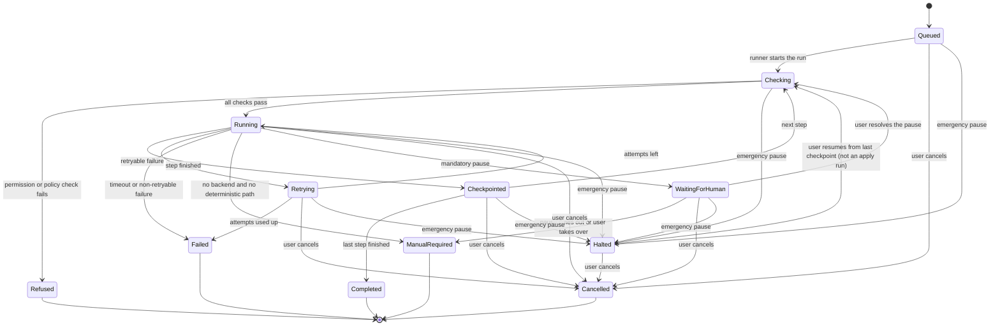

# JobPilot AI: Agent Workflow Specification

Status: draft for owner approval. Date: 2026-11-02. Source: [master spec](superpowers/specs/2026-11-01-jobpilot-master-spec.md) sections 9 and 11, [PRD](prd.md), [milestones](milestones.md), [AI providers](ai-providers.md), [policy register](policy-register.md), and [threat model](security/threat-model.md). Requirement IDs (`FR-<section>.<n>`) come from the PRD. **Release 0.6 is built:** the workflow runner, the resume, cover letter, career memory, tracking, analytics, discovery, matching, and research agents, the browser application agent (Manual, Copilot, and the Autonomous gate), the Claude Code apply session, execution logs, and emergency pause. The task types `parse_job`, `draft_resume`, `draft_cover_letter`, `classify_answer`, `semantic_match`, `summarize_company`, and `map_form_field` exist. The browser timeouts are the built values of decision 19 (section 4); the others are proposals for the owner to confirm, except the per-attempt defaults, which come from [AI providers](ai-providers.md#task-definition) and are also proposed there.

## 1. What an agent is

An agent is a deterministic workflow in Rust, run by the workflow runner in `jobpilot-core` (FR-11.10). It is not an autonomous model. Step order is fixed in code. A step may call the task router, which returns validated JSON or a typed failure.

- Models get no tools. The "allowed tools" below are core functions the workflow calls. A model cannot call them, and nothing in its output triggers one.
- Agents do not start one another. The GUI and CLI start runs through the same service (FR-10.13).
- Every agent works with no AI backend, through its deterministic path or by ending in `manual_required`. The router never invents output to fill a gap.
- A person starts every run. No run starts from page content or model output.
- **One exception, by owner decision, for one mode:** the Claude Code apply session is an interactive `claude` that chooses its own browser calls through JobPilot's `apply-mcp` proxy. Rust checks each call there, but the model, not the workflow, chooses the steps. See [section 5](#5-automation-modes).

## 2. Delivery by release

From the [milestones](milestones.md). Each agent lands with its feature.

| Release | Agents | Also lands |
|---|---|---|
| 0.2 | None (external backends start with Claude Code) | Task router, Claude Code headless adapter, consent record |
| 0.3 | Resume, cover letter, career memory, tracking, analytics | Workflow runner, execution logs, emergency pause |
| 0.4 | None | External backends widen what the router can reach: four hosted APIs, a loopback endpoint, and the Gemini CLI (Codex CLI ships inert). No agent changes. The refresh count states the true ceiling. |
| 0.5 | Discovery, matching, research | Connector SDK, the job store, and two new task types: `semantic_match` and `summarize_company` |
| 0.6 | Browser application (Manual, Copilot, Autonomous gate), Claude Code apply session | The pinned Playwright MCP runtime (`jobpilot browser setup`), the permissions engine (`permissions`), the `apply-mcp` proxy and its guards, form parsing (`forms`), and the task type `map_form_field` |

Before 0.5, the resume and cover letter agents took posting text the user pasted. From 0.5 they can also take a stored job. External backends start with Claude Code in 0.2 and widen in 0.4, so 0.3 agents use Claude Code, Ollama, or No-AI. After that, the router's checks decide.

## 3. Permission vocabulary

The 0.3 runner and the 0.6 permissions engine share these names. Concrete types come with each release plan.

| Permission | Meaning | First used |
|---|---|---|
| `read:job_text`, `read:company_text`, `read:profile_basic`, `read:resume_text`, `read:career_memory`, `read:sensitive` | Read that data class. Names match the [consent categories](ai-providers.md#consent-record). | 0.3 |
| `read:applications` | Read application history. | 0.3 |
| `read:matches` | Read stored match results. **Not yet used:** no 0.5 agent holds it. | Not used |
| `write:jobs`, `write:matches`, `write:company_notes` | Store discovered jobs, match results, and company notes. | 0.5 |
| `write:job_fields` | Store parsed fields on a job already stored. Cannot add a job. | 0.5 |
| `write:drafts` | Store generated documents as new versions. Never writes the knowledge base. | 0.3 |
| `write:career_memory` | Add questions and answers as unapproved. | 0.3 |
| `write:applications` | Add or change application records and status. | 0.3 |
| `write:reports` | Store computed analytics. | 0.3 |
| `model:<task_type>` | Send that task type through the router. All router checks still apply. | 0.3 |
| `embed:local` | Compute embeddings on a local model only (FR-2.4). | 0.3 |
| `net:connector` | Run a connector's read operation. Only the discovery agent holds it. | 0.5 |
| `apply:open_link` | Open a posting's link in the user's default browser. No automation. Built as `ApplyOpenLink`. | 0.6 |
| `apply:supply` | Show or copy prepared files and approved text to the user. Built as `ApplySupply`. | 0.6 |
| `browser:drive` | Run the Playwright server and a visible, isolated Chromium. Built as `BrowserDrive`. | 0.6 |
| `browser:fill`, `browser:upload` | Fill fields and upload the two staged files. Built as `BrowserFill`, `BrowserUpload`. | 0.6 |
| `browser:submit` | Submit a form. Built as `BrowserSubmit`. Only the Autonomous `submit` step and the Claude Code apply session use it; Copilot never clicks submit. | 0.6 |

Enforcement:

- Release 0.3: the runner checks each call against the agent's static set in the table in section 4 (FR-11.11). A set is fixed in code and has no user setting.
- Release 0.5: the connector gate also checks the operation and the source's status against the build-time register, before any request ([Connector SDK](connector-sdk.md#the-gate)). The discovery agent holds `net:connector`; the matching and research agents do not.
- Release 0.6: the permissions engine (`permissions::decide`, FR-9.5) also checks each action (`OpenLink`, `Supply`, `Drive`, `Fill`, `Upload`, `Submit`) against the site's register row, the mode, the verified list, and the user's stored grant. It refuses by default. Copilot and Autonomous call it again in every step, so a revoked grant stops the next step. The Claude Code apply mode reads no register row: `decide(ClaudeCode, ..)` allows every site and action once the owner has started a run (owner decision of 2026-11-01), and refuses one the owner did not start.

**No such permission exists** for a shell or terminal, reading a secret value, a free file path, free network access, approving an answer, lowering a sensitivity class, changing a register status, or answering a mandatory pause. No agent can be granted these. `read:sensitive` values stay in Rust and are never in a prompt with untrusted text ([threat model](security/threat-model.md#4-untrusted-input-and-prompt-injection)).

## 4. The nine agents

The table holds the nine agents of FR-11.1 to FR-11.9 and, as a tenth row, the Claude Code apply session (0.6), which is not one of them.

Timeouts exclude time waiting for a person, except the two browser rows: their wall clock includes holds (decision 19), because the runner's deadline is fixed when the run starts. "Router policy" means the [retry rules](ai-providers.md#timeouts-and-retries): the task's attempts per provider. A local provider retries network errors, 429, 503, and one validation failure. A hosted one retries 429, 503, and 529 once, and only when `Retry-After` gives whole seconds up to 30 (decision 11), plus one validation failure; it never retries a timeout, a network error, another 5xx, or a quota error. No retry follows authentication, policy, or consent refusals, cancellation, or a second validation failure. "Per attempt" means 120 seconds for a hosted API provider, 180 seconds for a CLI, and 300 seconds for local and for the endpoint.

| Agent | Release | Inputs | Outputs | Allowed tools | Permission scope | Timeout | Retry policy | Checkpoint | Cancellation |
|---|---|---|---|---|---|---|---|---|---|
| Discovery (FR-11.1) | 0.5 | Sources the person added (a Lever, Greenhouse, or Ashby board, a RemoteOK or We Work Remotely feed), postings the person pastes | Job rows marked untrusted with source and required attribution, duplicate groups (FR-6.2) | Read operations of connectors whose read row is `allowed` or `silent-read` (the two R1 rows, Greenhouse and Ashby), user-assisted import, deterministic duplicate check. No model. | `net:connector`, `read:job_text`, `write:jobs` | 30 seconds per request, 10 minutes per run | Two attempts per request on network errors, 429, 5xx, within the declared rate limit, honoring `Retry-After` up to 24 hours. No retry on a refusal. | After each source: its cursor, kept on the source row | Abort the request. Keep stored jobs. |
| Matching (FR-11.2) | 0.5 | Stored jobs, profile, preferences, knowledge base | Structured job fields, weighted score, missing skills, seniority, compensation and location match, reasons (FR-6.1 to FR-6.10), and a separate AI evaluation | Deterministic parsing, filters and scoring, `parse_job` and `semantic_match` through the router | `read:job_text`, `read:profile_basic`, `read:resume_text`, `model:parse_job`, `model:semantic_match`, `write:job_fields`, `write:matches`. **No `read:sensitive`** (decision 18). | Per attempt for model steps, 30 minutes per run | Router policy. The score is rules only, so it stands when a model step fails (FR-3.20). | After each step: job ids and counts | Cancel the task, kill any child. Keep finished jobs. |
| Resume (FR-11.3) | 0.3 | Knowledge base, one posting, template choice | Versioned draft with claim-level evidence, comparison with the original, DOCX and PDF on request (FR-7.5 to FR-7.11) | Evidence lookup, `draft_resume` through the router, template rendering, document export | `read:resume_text`, `read:profile_basic`, `read:job_text`, `model:draft_resume`, `write:drafts` | Per attempt, 30 minutes per run | Router policy. A reply that is not valid JSON, breaks the schema, invents a heading, or whose claims do not match the document's lines counts as a validation failure and stores nothing. A claim that cites no usable evidence (including an id outside the evidence list), or states work authorization, is stored flagged and blocks export until the user edits or removes it (0.2). With no backend, `manual_required` opens the editor (FR-3.23). | After a validated draft, and after each render | Cancel the task, kill any child, discard the unsaved draft. Earlier versions stay. |
| Cover letter (FR-11.4) | 0.3 | Knowledge base, one posting, company notes if any | Versioned letter with claim-level evidence, DOCX and PDF on request (FR-7.6, FR-7.11) | Evidence lookup, `draft_cover_letter` through the router, template rendering, document export | `read:resume_text`, `read:profile_basic`, `read:job_text`, `read:company_text`, `model:draft_cover_letter`, `write:drafts` | Per attempt, 30 minutes per run | Router policy. A reply that is not valid JSON, breaks the schema, invents a heading, or whose claims do not match the document's lines counts as a validation failure and stores nothing. A claim that cites no usable evidence (including an id outside the evidence list), or states work authorization, is stored flagged and blocks export until the user edits or removes it (0.2). With no backend, `manual_required` opens the editor. | After a validated draft, and after each render | Cancel the task, kill any child, discard the unsaved draft. Earlier versions stay. |
| Career memory (FR-11.5) | 0.3 | Questions and answers the user enters, questions from past forms from 0.6 on, which keep untrusted provenance | Unapproved questions and answers, retrieval results with provenance and freshness, sensitivity class (FR-8.1 to FR-8.7) | Question and answer store, local embeddings, deterministic sensitivity rules, `classify_answer` through the router, which may raise a class and never lower it | `read:career_memory`, `read:job_text`, `read:sensitive`, `write:career_memory`, `embed:local`, `model:classify_answer` | Per attempt, 10 minutes per run | Router policy. Retrieval falls back to FTS5 on non-sensitive text. | After each batch of embeddings or classifications | Stop between items. Missing embeddings are rebuilt on the next run. |
| Browser application (FR-11.6) | 0.6 | Application record, posting link, mode, site's register row, approved answers, chosen files | By mode, see section 5: prepared material, or a filled form with uploads; captured confirmation, pause records, status event for tracking (FR-9.7 to FR-9.15) | Manual: open link, supply material. Copilot (steps `open`, `detect`, `fill`, `review`), on a row recording "no clause found" or a local fixture: `apply::open_assisted`, the Playwright MCP client, `forms::parse_snapshot`, rule mapping (`forms::map_rules`, FR-3.22), `map_form_field` through the router for the textbox and combobox fields the rules leave, fill, upload. Copilot never clicks submit. Autonomous (steps `open`, `detect`, `fill`, `check`, `submit`, `confirm`): rule mapping only, no model call (decision 24), one submit click. | Static set (`BROWSER_APPLICATION`): `read:profile_basic`, `read:career_memory`, `read:sensitive`, `read:applications`, `write:applications`, `write:career_memory`, `read:job_text`, `browser:drive`, `browser:fill`, `browser:upload`, `browser:submit`, `apply:open_link`, `apply:supply`, `model:map_form_field`. Each step also asks `permissions::decide` for its mode and action: Manual gets `OpenLink` and `Supply`; Copilot adds `Drive`, `Fill`, `Upload`; only the Autonomous `submit` step holds `browser:submit`, and only its Copilot steps hold the model. | 2 hours wall clock per run, holds included (decision 19). A pause holds for 30 minutes (`PAUSE_HOLD`), then the item ends `manual_required` with nothing submitted. | Every step runs once (`attempts: 1`): Copilot `open`, `detect`, `fill`, `review`; Autonomous `open`, `detect`, `fill`, `check`, `submit`, `confirm`. Model steps follow router policy. **Submission is never retried**: an application with any earlier submission, in any mode (a submission row, a submitted or uncertain item, or status `applied` or later), is refused `already_submitted` by Copilot, Autonomous, and Claude Code apply runs until the person records the outcome. | After each step: ids and codes. **An apply run does not resume** (decision 21): `resume_run` returns `Validation`, and the owner starts a new run. | Close the browser, kill the server, and delete the profile at once. Nothing further is sent. A submission already sent stays sent and is recorded; a click with no result reads `uncertain`. |
| Claude Code apply session | 0.6 | Up to 25 applications in status `saved` with an `https` link (`MAX_RUN_ITEMS`), each with its chosen resume and letter, and the sealed answers the owner released at start | For each application: a submitted, skipped, uncertain, or `manual_required` item, pause records, a confirmation capture, an audit row, a note, and the status through the tracking agent | The owner's own `claude`, interactive, started by `jobpilot apply session <id>` with no tool of its own and one MCP server, `apply-mcp`, which offers `apply_next`, `apply_pause`, `apply_result`, and 13 browser tools. Rust checks every call (section 5). No router task: an apply session is a user-visible session (decision 6). | Static set (`CLAUDE_APPLY`): `read:profile_basic`, `read:career_memory`, `read:sensitive`, `read:applications`, `write:applications`, `write:career_memory`, `read:job_text`, `browser:drive`, `browser:fill`, `browser:upload`, `browser:submit`. No `model:*` and no `apply:*`. | 8 hours wall clock per run, holds included (decision 19). A pause holds 30 minutes, then the item ends `manual_required` and the run goes on. | `prepare` up to 3 attempts; `session` once. An application with any earlier submission is refused `already_submitted` at preflight and start. A second click on a control named to submit opens a pause, and Continue allows exactly one more; a click on a final button not named to submit is not counted (section 7). | Steps `prepare` and `session`. **An apply run does not resume** (decision 21); the owner starts a new run with what is left. | Kill `claude`, `apply-mcp`, the Playwright server, and Chromium by the run folder in their argv, delete the profile, then `claude purge` the session folder. |
| Tracking (FR-11.7) | 0.3 | Status edits by the user, from 0.6 on confirmation events from the browser application agent | Application status history (FR-2.12, FR-9.15) | Application store only. No model, no network, no mail reading. | `read:applications`, `write:applications` | 30 seconds per update | One retry on a busy database. | Each update is one transaction | Stop before the update. An update already under way finishes, and the run ends `completed`: all its steps are done, so a late cancel has nothing to stop. A halted update will not resume over a status that moved on after the run began; cancel it. |
| Research (FR-11.8) | 0.5 | A company's stored postings and the notes the person pasted | Company notes marked untrusted, each fact with the source it came from, gaps left blank (FR-6.9) | Stored-text lookup and `summarize_company` through the router. No crawler, no `web_search`, no connector read. | `read:job_text`, `read:company_text`, `model:summarize_company`, `write:company_notes`. **No `net:connector`** (decision 19). | Per attempt, 10 minutes per run | Router policy. With no backend, the stored text and notes stay, with no summary. | After each step: counts | Cancel the task, kill any child. Keep stored text. |
| Analytics (FR-11.9) | 0.3 | Application history | Local report figures (FR-10.11) | Aggregate queries in core. No model, no network. | `read:applications`, `write:reports` | 60 seconds per run | One retry on a busy database. | After each report section | Drop partial figures. |

Notes that bind the table:

- **Discovery.** It has two steps: `fetch`, which goes source by source and page by page through the one fetcher, then `dedupe`, which groups duplicates. The `allowed` read rows are Lever, RemoteOK, and We Work Remotely (RSS only). Greenhouse and Ashby are `silent-read`: the vendor is silent on third-party readers, and they are read under ruling R1, on a board the person names. **R1 was a controller ruling made while planning 0.5. It is not an owner decision**, and the owner can overturn it. Every other source enters through user-assisted import. A site read row that is `unknown` or `blocked` behaves as `blocked`, and the agent cannot run a connector for it. No model is called, and nothing a posting says chooses a step or a URL. A job with no company is tracked as "Company not stated" when a person adds it to the tracker.
- **Matching.** Three steps: `fields`, `score`, `semantic`. `fields` lets `parse_job` fill blanks the rules left empty. A model never sets pay: only the deterministic parser does. A model sets `work_mode` or seniority only when the word is in the posting and is not negated. `score` is rules only, with fixed weights (skills 40, seniority 20, location 20, pay 20). A criterion that cannot be compared is left out, and unknown is never a mismatch. `semantic` stores a separate "AI evaluation" (fit, summary, strengths that cite real evidence, gaps) that never changes the score, a filter, or the order. A person starts an AI press, and it covers at most 20 named jobs (`MATCH_BATCH`) with the most calls stated first. **Decision 18:** the agent holds no `read:sensitive`. Stated authorization values are compared deterministically and only per country, at display time, by `jobs::authorization_note`, and nothing stores one. A missing value is reported as "not stated", never as eligible or ineligible (FR-4.10).
- **Resume and cover letter.** Only user-entered or user-approved material counts as evidence. A draft does not become evidence by being saved. Neither agent holds `read:sensitive`. `read:resume_text` withholds user-marked documents and lines. Unmarked text can still state visa status, citizenship, or salary ([threat model](security/threat-model.md#11-residual-risks)).
- **Career memory.** Only the user approves an answer or lowers a class (FR-8.4). Sensitive answers are not embedded. Work-authorization answers are found by exact country key, not by similarity.
  - As built in 0.3, `classify_answer` is one attempt per question, no retry, and at most 20 questions (`CLASSIFY_BATCH`) per refresh. Only a person starts a refresh: there is no timer, no startup run, and no hook on adding a question. Before any paid or subscription call the GUI and the CLI state the most calls the press can make: the pending questions (at most 20) times the external providers that could take each, since a failed reply goes on to the next provider. The 20-question limit is stated separately. Resuming a halted refresh makes none. A refresh that finds no usable model finishes with the class the rules gave.
  - **A person's sensitivity class is final.** `classify_answer` skips every question whose `class_source` is `user`, so a class a person set, raised or lowered, is never changed by a model. A model may still raise a class the rules or a model set. The classifier sees question text only, never an answer.
  - A work-authorization answer is not stored in memory. It is read from the encrypted profile row for one exact country, and a country with no stated value reads "not stated".
- **Browser application.** `map_form_field` sees form text and candidate answer ids, never answer values, and only Normal fresh answers are candidates. The model returns an id or nothing, Rust checks the id is listed, and Rust fills the value. This keeps Sensitive-class values out of a prompt that holds untrusted text. At most 20 fields a run go to the model (`MAX_MODEL_FIELDS`). A field the rules and the model leave goes to the person at the review stop. **Autonomous makes no model call** (decision 24): its `detect` step holds no `model:*` permission and maps by rules only, so the router's `unreviewed` mode is not needed yet. `classify_answer` in the career memory agent likewise sees question text only. Both tasks declare `job_text`, in every release and whatever the question's source, so stored form questions cannot escape the no-tools rule.
- **Research.** Two steps: `gather` reads the company's stored text, and `summarize` asks `summarize_company` through the router. An automated read of an arbitrary site is `unknown` in the register, so this agent reads no company site directly. **Decision 19:** it holds no `net:connector`. Connector data is already stored by a fetch, so a person fetches first. Rust keeps only a fact whose `source` names a listed source, whose text is short, states no work authorization, and whose words that source holds. Anything else is dropped and counted. A reply that cannot be used leaves the stored notes as they were.
- **Analytics (decision 22).** `read:matches` is not added. The analytics agent has no match figure in 0.5.
- **Claude Code apply session (decisions 1 to 26 of the 0.6 plan).** `jobpilot apply session <id>` hosts one run on the runner, in the terminal panel from the GUI or in a plain terminal from the CLI, and `claude` is its child. It is not a router task (decision 6): it is a user-visible session that holds page text and the facts of one application at a time, and its tools are only the proxy's. Facts come from `apply_next`'s brief, one application at a time: profile basics, approved fresh answers, and the sealed answers and work-authorization values the owner released at start. Nothing is in argv or the system prompt. The proxy stages that application's two files before each brief. Questions the session meets with no answer go to career memory through `apply_pause` with `kind: no_answer`, stored unapproved with form provenance (`source = 'form'`).
- **Every model task** carrying `job_text` or `company_text` requires a provider declaring `no_tools` ([threat model](security/threat-model.md#7-cli-adapters-and-untrusted-text)). Every task above is `reviewed`. Autonomous calls no model, so no `unreviewed` task runs in 0.6.

## 5. Automation modes

The browser application agent runs in one of three modes, and the owner added a fourth, the Claude Code apply mode (the last row below). All four are built in 0.6. The first three must be earned by a register row, or under owner decision D2 for Copilot, by a row recording "no clause found". A user cannot override a site row that is `blocked` in those three modes. The Claude Code apply mode is the owner's recorded exception, for the owner's own accounts only (see [the policy register](policy-register.md#owner-decision-2026-11-01-claude-code-apply-mode-release-06)).

| Mode | Needs | Agent does | Today |
|---|---|---|---|
| Manual | A `user-assisted` apply row | Opens the link in the user's default browser, supplies files and text, records the outcome. No request to the site and no browser driven there. The user fills and submits. | **Built.** Available on every site. The review screen and `jobpilot apply material`, `apply record`. A sealed answer is copied only after a native confirmation, by Rust, and the clipboard is cleared after 60 s. |
| Copilot | The site's own `allowed` Copilot row, or a Copilot row recording "no clause found" (D2) | Drives an isolated browser, fills, uploads, stops. The user reviews and clicks submit. A human click does not substitute for the row. Eligible on Greenhouse, Lever, and Ashby hosted forms, recorded as "no clause found". Workday (a clause may reach it) and LinkedIn (not read) stay refused, and Indeed is `blocked`. Pauses for CAPTCHA, MFA, identity verification, and legal declarations always apply. | **Built.** Greenhouse, Lever, and Ashby, recorded as "no clause found" on the run. `jobpilot apply copilot` and Start Copilot on the review screen. It clicks no button but a landing link named exactly `apply`, `apply now`, or `apply for this job`, and ends at a review stop where the person clicks submit. |
| Autonomous | The site's own `allowed` row, verified connector permission, and explicit user authorization (FR-9.6) | Also submits, in one attempt. A field left for a person or a changed page pauses; a page with a legal declaration or an identity request ends the item `manual_required` (`legal_declaration`), and the person submits it. | **Default off. Zero eligible connectors.** Every hosted-form row for this step is `unknown` or `blocked`. **Built as a gate:** `permissions::VERIFIED` is empty, so nothing is eligible. `jobpilot apply autonomous run <application>` and Tauri `autonomous_start` are refused with the policy reason, with no run row, no browser, and no dialog. Grants: `apply autonomous grant`, `revoke`, `list`. |
| Claude Code apply (owner decision of 2026-11-01) | The owner's own accounts, and the owner starting a run. No register row and no per-application check. | The app starts the user's own `claude`, in its terminal panel or a plain terminal, with JobPilot's `apply-mcp` proxy in front of the Playwright server and a visible Chromium, on any site including Indeed, LinkedIn, and Workday. The session submits applications without asking per application once the owner starts a run. It sees only approved answers and profile facts, uses browser tools only, and may upload only the chosen resume and letter. It stops for sign-in, CAPTCHA, MFA, identity checks, and legal declarations, with no bypass. Every application is logged and tracked, and emergency pause kills every process of the run. | **Built.** `Apply with Claude Code...` on Applications, or `jobpilot apply start <ids> [--release-sealed]`. Risk the owner accepted: the site may restrict or ban the account. |

Autonomous steps are `unreviewed`, so the router's [mode check](ai-providers.md#routing) refuses every OpenAI-origin model on any step of a submission, and any provider that cannot leave human confirmation in place. A site's row applies whichever model runs. Decision D2 (2026-11-01) keeps Autonomous default-off.

**Claude Code apply mode, as built.** It overrides the `blocked` and `unknown` site rows and decision D2 for this mode only, and only for the owner's own accounts. It is the owner's call, made on 2026-11-01 for Release 0.6, and it does not change Manual, Copilot, or Autonomous. What stays in force in this mode:

- Only approved answers and profile facts are used. Nothing is invented and nothing infers work authorization.
- Browser tools only. The only files the session may reach are the resume and letter chosen for that application.
- The mandatory pauses of section 6 for CAPTCHA, MFA, identity verification, and legal declarations apply, and nothing bypasses them.
- Every application is logged and tracked, with the same audit and execution-log rules as any run.
- Emergency pause (section 8) stops the session.

How each rule is enforced, with no setting that turns it off:

- **Two walls on tools.** `claude` starts with `--tools ""`, `--strict-mcp-config` with one server, `--allowedTools mcp__jobpilot__*`, and `--permission-mode dontAsk`, plus `--setting-sources ""`, `--disable-slash-commands`, hooks off, and `CLAUDE.md` and auto memory off (`argv_is_exactly_the_verified_list`). Playwright is a child of the proxy and never in `claude`'s config. The proxy lists 3 apply tools and 13 browser tools filtered by name, and refuses any other name, any `filename` or `isolatedContext` argument, `browser_type.submit`, a key other than Tab, Shift+Tab, or Escape, a non-`https` address (`http` on loopback in debug builds only), and a target that is not a ref in the last snapshot.
- **Facts only.** Every typed value must equal, or be a contained part of, an approved answer or profile fact from the brief (`guard::value_ok`); otherwise the call is refused with "not an approved answer or profile fact; call apply_pause". A work-authorization label needs its stated value for the application's exact country, on an exact template; a field whose label the rules class as legal is refused; a choice is judged by its question. Sealed values are in the session only for an application the owner released them to, at start, in one native dialog (CLI `--release-sealed`).
- **Two files.** Before each brief the proxy empties `<run>/files` and copies in that application's `resume.pdf` and `cover-letter.pdf`. An upload path must equal one of those two, checked in Rust. `claude` has no file tool and never reads them.
- **Stops.** After each action the proxy takes its own snapshot, and every snapshot goes through `guard::scan`. A hit holds the tool reply and opens a pause that only a person ends, in the GUI or with `jobpilot apply resolve`. The model can open a pause with `apply_pause` and has no tool that ends one.
- **Logged and tracked.** The proxy counts submit clicks from its own snapshot. `apply_result` reports the outcome, and Rust writes the item, a confirmation capture (recorded as the page's claim, not as proof), an audit row, a note, and the status through `agents::set_status`. `submitted` with no observed click is stored `uncertain`.
- **Emergency pause.** Three independent paths kill the run: the session host's 250 ms watch, the desktop closing the apply PTY before it writes the pause row, and the proxy refusing every call while the flag is set. The sweep kills every process whose argv names the run folder.

## 6. Mandatory pauses

From spec section 9: "Always pause for legal declarations, unverified sensitive information, identity verification, CAPTCHA, MFA, and other actions requiring human intervention."

| Pause | Requirement | Trigger | Resolved by |
|---|---|---|---|
| Legal declarations | FR-9.16 | Attestation, consent, signature, or truthfulness statement. Any question about AI use or authorship, per the [register](policy-register.md#ai-use-rules-that-bind-the-product-across-providers). | The user reads and answers it. JobPilot never answers it. |
| Unverified sensitive information | FR-9.17, FR-8.8 | A sensitive field with no approved answer, a stale answer, a pre-filled value, or any sensitive or legally consequential answer not yet confirmed for this use. | The user confirms or enters the value. |
| Identity verification | FR-9.18 | Any request to prove identity. | The user does it, or ends the run. |
| CAPTCHA | FR-9.19, FR-5.16 | Any CAPTCHA or bot challenge. | The user solves it in the visible browser, or ends the run. No solver, no bypass. |
| MFA | FR-9.20, FR-5.17 | Any second-factor prompt. | The user does it, or ends the run. JobPilot never sees or stores the code. |
| Other human intervention | FR-9.21 | `Login`: a sign-in page (stored as kind `login`, shown under this row with "Sign in, in the browser window."). A required field with no mapping, a page that differs from what the user reviewed, a redirect off the permitted origin (Copilot), an unexpected alert dialog, a second submit click, an uncertain submission result, or any doubt. | The user decides. |

Rules:

- A pause applies in Copilot, Autonomous, and the Claude Code apply mode, and a model or a setting can never answer it. A run cannot be configured to skip one.
- **In apply mode Rust scans each page.** The proxy takes its own snapshot after each action, and every snapshot it forwards or takes goes through `guard::scan`, with no exception (`every_snapshot_is_scanned_with_no_exception`). The scan rests on word lists, so a stop the lists do not name can be missed ([threat model](security/threat-model.md#11-residual-risks)). A line a person already answered on that page does not pause again; a new line does (`an_answered_line_does_not_pause_again`, `a_new_line_on_the_same_page_pauses`).
- Page text and model output can start a pause and can never end one. Only a user action through the GUI or CLI ends it.
- Doubt resolves to a pause. In Copilot and Autonomous nothing submits with an unknown field. In the Claude Code apply mode the session decides when the form is complete; the proxy does not check that the fields are filled before a submit click.
- In Manual, the user is already filling the form. The sensitive rule still applies: JobPilot supplies a sensitive answer only after confirmation (FR-8.8).
- After a pause, the run goes back through the checks in section 7 before continuing.

## 7. A run

| State | Meaning |
|---|---|
| Queued | Accepted, waiting for the runner. |
| Checking | Runner checks the agent's permission set and whether emergency pause is off. From 0.6, the permissions engine also checks the action. Re-run before every step, so a revoked authorization stops the run. The router makes its own policy and consent checks on every task. |
| Running | One step in progress under its timeout. |
| Checkpointed | Step result stored. The run can resume from here. |
| Retrying | Waiting to try again under the agent's retry policy. |
| WaitingForHuman | A mandatory pause. Used from 0.6 by the browser application agent and the Claude Code apply session (`store::set_waiting`, which another process such as `apply-mcp` may set). For these two agents the run timeout keeps running through a hold (decision 19). |
| Halted | Stopped by emergency pause, or `interrupted`. Stays here until a person acts. **An apply run (browser application or Claude Code apply) does not resume** (decision 21): a live page cannot be resumed, so `resume_run` refuses it with `Validation`, and the owner starts a new run with what is left. Every other halted run can resume. `interrupted` means the process that ran it died (the app was closed or crashed): its heartbeat went old, and any later read moves the run to `halted` with the reason `interrupted`, so a row never reads `running` forever. It does not resume on its own. |
| Completed | Finished with validated results. |
| ManualRequired | No path remains without a person. Matches the router's `manual_required`. |
| Refused | A check failed. Nothing ran for that step. |
| Failed | Timeout or typed failure. Matches the router's `failed`. |
| Cancelled | Ended by the user. Matches the router's `cancelled`. |

A step's model task is handled by the router, including provider fallback. A router `failed` result reaches this diagram as a non-retryable failure, so model attempts are not counted twice.

### Execution logs

Every state change writes an execution log row (FR-11.12): run id, agent, step, state, duration, provider if any, data categories, and outcome. Logs never contain prompts, outputs, secrets, or decrypted sensitive values. Page text and job text are also excluded. The `agent_run` table comes with the 0.3 migration ([schema](database-schema.md#3-release-03-tables-decided-shipped)). The CLI and GUI read the same rows (FR-10.12).

Audit rows (FR-12.7) use actor `system` for a run's own actions, with the agent name in `detail`, and `gui` or `cli` for what a person does: external provider calls, submissions, emergency pause, resuming, and Autonomous authorization or revocation.

### Checkpoints

A checkpoint (FR-11.15) stores the step reached and references to stored results by id. It holds no prompt, no output text, no secret, and no decrypted sensitive value. A resumed run re-runs Checking and reads its data again, so it never acts on a stale permission.

### Cancellation

Cancellation (FR-11.16) takes effect at once: the in-flight router task is cancelled, any child process is killed, and any browser is closed with its profile deleted. A finished step's stored result stays unless the table in section 4 says otherwise. A cancelled run cannot resume.

### Submission safety

`browser:submit` is never retried by the app. Any earlier submission of an application, in any mode, blocks it from Copilot, Autonomous, and Claude Code apply runs with `already_submitted` until the person records the outcome. If the app cannot tell whether a submission went through (crash, timeout, emergency pause mid-request, a lost reply after the click), the run does not retry. The item ends `uncertain`, shown as "Check the site. JobPilot will not try again.", and the user checks the site and records the outcome. An apply run never resumes. In the Claude Code apply mode the count covers only a control named to submit (`submit`, `send application`, `finish application`): a second click on it opens a pause, and Continue allows exactly one more (`a_second_submit_click_pauses`), but a second click on a final button named "Apply", "Continue", or "Done" is neither counted nor paused, so a double submission on such a form is possible ([threat model](security/threat-model.md#11-residual-risks)).

## 8. Emergency pause

Emergency pause (FR-12.8) landed in 0.3, and from 0.6 it also halts browsers.

- **Where.** The title bar's Emergency pause button is the first tab stop on every screen. The native `Safety` menu has an Emergency pause item. The shortcut is `Ctrl+Shift+H` (`Cmd+Shift+H` on macOS), as a menu accelerator and as a capture listener in the webview. The CLI has `jobpilot pause set`, `jobpilot pause status`, and `jobpilot pause clear`.
- **The shortcut is not the reliable path.** `wry` 0.57.1 passes `performKeyEquivalent` to the `WKWebView` first, so on macOS `Cmd+Shift+H` may not fire while the web process is hung. Clicking **Safety > Emergency pause** in the menu bar is the reliable path, and so is `jobpilot pause set` from any terminal. The same gap has not been looked for on Windows. Neither the key nor the menu was driven by a person in a real window for this release.
- **What it does.** It cancels every in-flight task, kills child processes, and moves each active run to Halted. Each running process polls the stored flag every 250 ms (the desktop's model pull and index work every second), so a pause set from the CLI stops a run the desktop started, and the reverse. A `jobpilot` command run inside the terminal panel is stopped the same way. A `claude` session the user started in the panel is the user's own and is not stopped (M-14). A Claude Code apply session is different: Rust chose it, and pause kills it, its `apply-mcp`, the Playwright server, and Chromium within 2 s, from the desktop path or the CLI path, and the run ends `halted`. Copilot and Autonomous runs close their browser the same way.
- **The flag is stored in the database**, so the desktop app and CLI both see it, and it survives a restart. While set, no run starts, no model call or embedding starts, a model pull is refused, and queued runs do not proceed. A run that is started returns `paused` and writes no row.
- **Application status edits are refused with `paused`**, because a status change runs through the tracking agent. Editing fields and notes stays open. Cancelling a run stays open.
- **A restore keeps the flag.** A backup never clears the pause, and a restore with an unreadable pause state comes up paused, because failing closed costs one click.
- Runs never resume on their own. The user clears the flag, then resumes or cancels each run. A resumed run passes through Checking. **An apply run does not resume** (decision 21): the owner starts a new run, and the new run skips nothing that ended. A submission made before the pause stays recorded, and `jobpilot apply settle` (or Record status on the run screen) writes its status once the pause is cleared.
- Setting and clearing the pause each write an audit row (`emergency_pause_set`, `emergency_pause_cleared`), under `gui` or `cli`. Clearing from the GUI asks through a native dialog, and `pause clear` is refused inside the terminal panel for the same reason. The `system` actor cannot set or clear.

## 9. Spec section 11 coverage

| Spec requirement | Requirement ID | Where |
|---|---|---|
| Nine agents | FR-11.1 to FR-11.9 | Section 4 |
| Deterministic workflow first | FR-11.10 | Section 1 |
| Restricted permissions | FR-11.11 | Sections 3 and 4 |
| Execution logs | FR-11.12 | Section 7 |
| Timeouts | FR-11.13 | Section 4 |
| Retries | FR-11.14 | Section 4 |
| Checkpoints | FR-11.15 | Sections 4 and 7 |
| Cancellation | FR-11.16 | Sections 4 and 7 |
