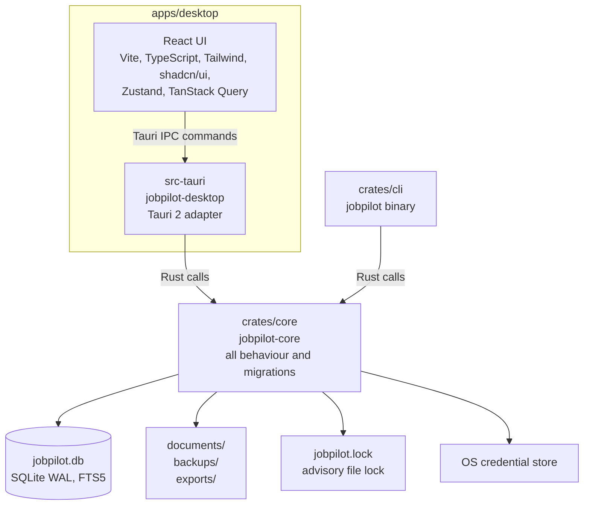
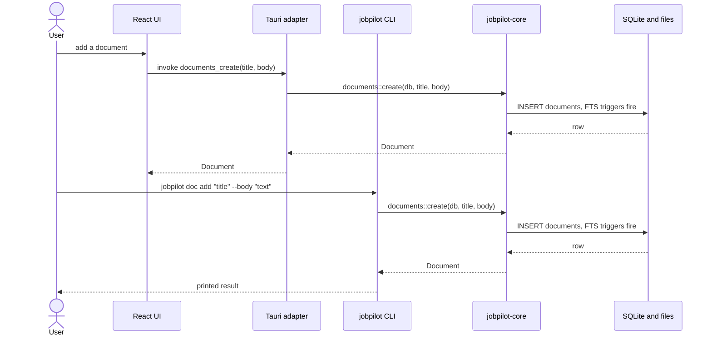

# JobPilot AI: Architecture

Status: draft for owner approval. Source: [master spec](superpowers/specs/2026-11-01-jobpilot-master-spec.md), [PRD](prd.md), and [milestone plan](milestones.md). Requirement IDs (`FR-<section>.<n>`) come from the PRD. Nothing here is implemented yet. This document describes release 0.1 in detail and names later pieces only as extension points.

Related documents: [AI providers](ai-providers.md), [policy register](policy-register.md), [threat model](security/threat-model.md), [agents](agents.md). They own connector, AI, security, and agent design. This document does not specify those designs. The database is described in [database-schema.md](database-schema.md).

## 1. Principles

- One library holds all behaviour (FR-10.13). The desktop app and the CLI are thin adapters over it.
- Local first. All user data lives under one data root on the user's machine (FR-2.1, FR-2.3). Release 0.1 makes no network call.
- No mandatory account, API key, or hosted backend (PRD goal G3).
- Targets are macOS (arm64, x86_64) and Windows x64 (FR-1.8).
- The webview never receives a secret value (FR-12.2, FR-2.9).

## 2. System context


The dotted edge does not exist in 0.1. Its rules are owned by the [AI providers](ai-providers.md) and [policy register](policy-register.md) documents.

## 3. Containers



| Container | Path | Role |
|---|---|---|
| React UI | `apps/desktop/src` | Renders views, calls typed IPC functions. Holds no business logic. |
| Tauri adapter | `apps/desktop/src-tauri` | Cargo package `jobpilot-desktop`. Exposes core services as Tauri commands. |
| CLI | `crates/cli` | Binary `jobpilot`. Parses arguments, calls core, prints text or JSON. |
| Core | `crates/core` | Crate `jobpilot-core`. All behaviour, error types, and `migrations/`. |
| Data root | see section 6 | One folder holding the database, documents, backups, exports, and lock. |

## 4. The GUI and the CLI reach the same service

Both adapters resolve the same data root, open the same database through `Db::open`, and call the same core function. They differ only in the `actor` string written to the audit log (`"gui"` or `"cli"`). This satisfies FR-10.13.



If the desktop app and the CLI run at the same time, SQLite WAL and the advisory lock (ADR 4) keep them from corrupting each other. Operations that replace the live files (restore, delete-all) are refused with `in_use` while another process holds a handle.

## 5. Repository structure

```text
jobpilot/
  Cargo.toml                 Cargo workspace
  rust-toolchain.toml        pins Rust 1.99.1
  package.json               pins pnpm@12.16.1
  pnpm-workspace.yaml
  crates/core/               jobpilot-core: all behaviour, migrations/
  crates/cli/                jobpilot binary
  apps/desktop/              React app
  apps/desktop/src-tauri/    Tauri adapter
  docs/                      published documentation
  .github/workflows/         ci.yml, release.yml
```

Cargo workspace members: `crates/core`, `crates/cli`, `apps/desktop/src-tauri`. The pnpm workspace covers `apps/desktop`. The workspace and shell are created in plan Task B1. This maps to FR-13.1.

Toolchain: Rust 1.99.1, Tauri 2.12, SQLx 0.9 with bundled SQLite, React 19, Vite 8.

## 6. Components

### 6.1 `crates/core` (`jobpilot-core`)

A library crate. It contains every behaviour in the product and nothing that depends on Tauri or on terminal I/O. Modules shipped in 0.1:

| Module | Responsibility | Requirements |
|---|---|---|
| `error` | Single `Error` enum and `Result<T>`. Each variant has a stable `code()` such as `in_use`. Serializes as `{"code", "message"}`. | Supporting; no FR of its own |
| `paths` | `AppPaths`: resolves the data root and the paths inside it. | FR-2.3 |
| `db` | `Db`: opens SQLite, applies pragmas, takes the file lock, checks schema version, snapshots and migrates. Exports `MIGRATOR`. | FR-2.1, FR-2.5 |
| `settings` | Key/value settings stored as JSON text. | Supporting storage; no FR of its own |
| `audit` | Append-only record of consequential actions. | FR-12.7 |
| `documents` | Create, read, update, delete, and search documents. Search uses FTS5. | FR-2.2, FR-2.3, FR-2.11, FR-3.21, FR-3.23 |
| `backup` | Create, list, and restore validated backups. | FR-2.6, FR-12.9 |
| `secrets` | Store secret values in the OS credential store and keep an index of names in the database. There is no read path outside Rust callers. | FR-2.9, FR-12.2 |
| `transfer` | Export all data and delete all data. | FR-2.7, FR-2.8, FR-12.10 |

Modules added in 0.2:

| Module | Responsibility | Requirements |
|---|---|---|
| `crypto` | The data key, AES-256-GCM field encryption, and `state`/`peek`, which classify the key as not loaded, unlocked, unavailable, missing, or mismatched. Opening a database never touches the keychain; the first sensitive use does. | FR-12.1 |
| `recovery` | Recovery-key export and import, and discard of locked fields behind a `pre-discard` snapshot. | FR-12.1 |
| `profile` | The international candidate profile. Work authorization is stored as stated, per country, encrypted, and never inferred. | FR-4.1 to FR-4.10 |
| `knowledge` | Knowledge base items (user-marked sensitive bodies sealed) and pasted job texts, normalized as untrusted. | FR-7.3, FR-12.3 |
| `parse` | PDF and DOCX resume import under size, time, and expansion limits. | FR-7.1, FR-7.2 |
| `render` | Resume model, two templates, DOCX and PDF output (DejaVu Sans embedded). | FR-7.5, FR-7.6 |
| `drafts`, `generate` | Versioned drafts with claim-level evidence, the guards in front of an export, and the prompts that produce them through the router. | FR-7.7 to FR-7.12 |
| `embed`, `hardware` | Embeddings stored as `f32` BLOBs with brute-force cosine search; machine memory and CPU for model fit. | FR-2.4, FR-3.5 |
| `ai` | `Router`, `Provider` and its three implementations (`Ollama`, `ClaudeCode`, `NoAi`), `validate`, and `consent`. See [AI providers](ai-providers.md#as-built-in-02). | FR-3.1 to FR-3.30 |

Data root layout, resolved by `AppPaths`:

```text
<root>/jobpilot.db       SQLite database (WAL mode)
<root>/documents/        user document files
<root>/backups/          snapshots and backups
<root>/exports/          data exports
<root>/jobpilot.lock     advisory lock file
<root>/.jobpilot-root    ownership marker holding the app identifier
<root>/.jobpilot-swap    present only while a restore is renaming files into place (0.2)
```

`<root>` is `JOBPILOT_HOME` when set, otherwise `dirs::data_dir()/io.github.gvsrusa.jobpilot`.

A root must be proven to be JobPilot's before anything touches it, because `JOBPILOT_HOME` can name any folder and on a case-insensitive volume `<home>/documents` is the user's `~/Documents`. `Db::open` and `backup::restore_offline` write `.jobpilot-root` first into a new or empty root, proceed if the marker exists, and refuse a non-empty root without one with `root_not_owned`, creating nothing. `transfer::delete_all` also refuses without the marker. Delete-all removes JobPilot's named paths only, and a symlink at one of those names goes without its target. It leaves `.jobpilot-root`, so a retry or the next open still finds an owned root; `jobpilot.lock`; `backups/` unless backups are included; and any file JobPilot did not name.

`Db::open` order: check the root's marker; create directories; take a shared lock on `jobpilot.lock` (a held exclusive lock maps to `in_use`); connect with `create_if_missing`, WAL, a 5 second busy timeout, and foreign keys on; read the highest applied migration and return `schema_too_new` if it exceeds the version the app knows; if migrations are pending, take the exclusive lock, write a `pre-migrate-<from>` snapshot when upgrading an existing database, run the migrations, and return to the shared lock.

Backup layout: `backups/<label>-<UTC stamp>/` holds `jobpilot.db` (written with `VACUUM INTO`), a copy of `documents/`, and `manifest.json` with `{format: 1, schema_version, created_at, wal}`. Restore validates the backup before touching live data, writes a `pre-restore` snapshot, closes the handle, and takes the exclusive lock. It then builds the new database as a temporary copy inside the root: it merges a WAL only if the manifest claims one, migrates an older backup forward, checks the schema, puts back the live `secret_index` names because secret values are never in a backup, writes the audit row, and checks the copy again. Next it renames the documents into place, clears the live `-wal` and `-shm`, renames the database into place, and reopens. A failure before the database rename leaves live data unchanged. Once that rename succeeds the restore has happened, so a failed reopen returns `restored_not_opened` rather than an error that reads as nothing changed. If step 2 fails on a corrupt database that still opens, restore falls through to the offline path, which copies the files instead of reading rows. Nothing deletes snapshots automatically.

Planned later modules (connector SDK, workflow runner, permissions engine) will be added to this crate in later releases. Their designs belong to the documents listed at the top and are not decided here.

### 6.2 `crates/cli` (`jobpilot`)

A binary crate that depends on `jobpilot-core`. It parses arguments, calls core with actor `"cli"`, and prints text or, with `--json`, JSON. Errors go to standard error as `error[<code>]: <message>` with exit code 1. The 0.1 surface is `status`, `doc`, `backup`, and `data`. It contains no business logic. Later releases add the commands in FR-10.3 to FR-10.12. This is the 0.1 slice of FR-10.13.

The 0.2 CLI adds `profile`, `prefs`, `kb`, `job`, `resume`, `letter`, `ai`, and the `data recovery-key` commands, plus `jobpilot shell`, the restricted line interpreter the terminal panel runs. The desktop bundles this binary as a sidecar (`externalBin: binaries/jobpilot`). `apps/desktop/scripts/sidecar.mjs` builds it and copies it to `binaries/jobpilot-<target triple>`; `beforeBuildCommand` runs it, with `TAURI_ENV_TARGET_TRIPLE` set under `tauri build --target`, and CI runs it as its own step. Under `tauri dev` the script is not run, so build the CLI first.

### 6.3 `apps/desktop/src-tauri` (Tauri adapter, package `jobpilot-desktop`)

Holds `AppState`, which contains the `AppPaths`, an `RwLock<Option<Db>>` slot, and a `Mutex<Option<StartupError>>`. At startup it resolves paths and tries `Db::open`. If that fails (for example `schema_too_new`), it stores a `StartupError` and the app starts in recovery state instead of panicking. Commands that need data return `unavailable` in that state. `status` and `retry_open` always work.

`backup_restore` and `data_delete` take the write lock, take the `Db` out of its slot, call core, and always reopen before returning. There is deliberately no `secret_get` command, so secret values never cross IPC. The adapter uses the single-instance plugin so a second launch focuses the existing window, and the dialog plugin with only `dialog:allow-open` permission to pick a backup folder. The webview Content Security Policy and capabilities are locked down in plan Task B1.

In 0.2 the adapter also holds `pty.rs`, which runs the sidecar in a PTY (`portable-pty`) for the panel with a marker in its environment so core can refuse the commands M-14 lists; `native.rs`, which owns the native dialogs for recovery files and destructive confirmations so those paths never cross the webview; and the AI commands. The webview cannot set `ai.claude_path`, give consent, or enable a provider through the panel. Exit cancels in-flight tasks and waits up to 5 seconds before leaving.

### 6.4 `apps/desktop/src` (React frontend)

Built with Vite, Tailwind CSS, shadcn/ui, Zustand for client state, and TanStack Query for async state (FR-1.2, FR-1.3, FR-1.5 to FR-1.7). Areas in 0.1:

| Area | Path | Purpose |
|---|---|---|
| IPC layer | `src/lib/ipc.ts` | One typed function per Tauri command. Types are hand-written and kept in sync with the adapter. |
| UI store | `src/lib/store.ts` | Zustand store holding the current view. |
| Status view | `src/views/StatusView.tsx` | Schema version, app version, data root, and database state. |
| Documents view | `src/views/DocumentsView.tsx` | List, create, edit, delete, and search documents. |
| Data view | `src/views/DataView.tsx` | Backup, restore, export, delete-all, secrets, and recent audit entries. |
| Recovery view | `src/views/RecoveryView.tsx` | Shown when the database failed to open. Offers retry and restore from backup. |
| Profile view | `src/views/ProfileView.tsx` | Name, places, work modes, work authorization, locked fields, and the recovery-key panel (0.2). |
| Resumes view | `src/views/ResumesView.tsx` | Resume import, knowledge items, job texts, drafts, comparison, and export (0.2). |
| AI view | `src/views/AiView.tsx` | Providers, order, consent, Ollama models and downloads, and the Claude path (0.2). |
| Terminal panel | `src/components/TerminalPanel.tsx` | xterm.js on the PTY. Ctrl+` shows or hides it, F6 leaves it (0.2). |

Screen layouts are in the UI wireframes (plan Task A5) and are not repeated here.

## 7. Architecture decision records

### ADR 1: Core library plus thin adapters

- Context: the GUI and the terminal must call the same underlying services (FR-10.13), and tests must run without a window.
- Decision: put all behaviour in `jobpilot-core`. The Tauri app and the CLI only translate input and output and pass an actor name.
- Consequences: behaviour is tested once, in core, with a temporary data root. Adapters stay small. A new adapter, such as a PTY panel in 0.2, reuses core unchanged. The cost is that core must not depend on Tauri types.

### ADR 2: Runtime SQLx queries

- Context: SQLx can check queries at compile time (`query!`), which needs `DATABASE_URL` or `sqlx-cli` at build time.
- Decision: use the runtime `sqlx::query` functions. Migrations still run through `sqlx::migrate!()`.
- Consequences: a clean checkout builds on macOS and Windows with no database and no extra tool. Query mistakes surface in tests, not at compile time, so each query needs a test. Revisit if the query count makes this costly.

### ADR 3: One data root, not Tauri path APIs

- Context: Tauri path helpers are available only inside the desktop app. The CLI must find the same files.
- Decision: core resolves the data root itself: `JOBPILOT_HOME` if set, otherwise `dirs::data_dir()/io.github.gvsrusa.jobpilot`. The app identifier is `io.github.gvsrusa.jobpilot`.
- Consequences: the GUI and CLI always agree on the location. Tests and portable setups can redirect everything with one environment variable. The location follows platform conventions through `dirs`.

### ADR 4: Advisory file lock for multi-process safety

- Context: the desktop app and the CLI can run at once. WAL handles concurrent reads and writes, but restore and delete-all replace files and must not run while another process is attached.
- Decision: every `Db` holds a shared lock on `jobpilot.lock`. Migration, restore, and delete-all take it exclusively. A lock that cannot be taken returns `in_use`.
- Consequences: normal use from both adapters works together. Destructive operations are refused rather than racing. The lock is advisory, so it protects only processes that use JobPilot core, which is the intended scope.

## 8. Extension points for later releases

These are named so that 0.1 does not block them. They are not designed here.

| Later area | Release | Owner document |
|---|---|---|
| AI task router and providers | 0.2, 0.4 | [ai-providers.md](ai-providers.md) |
| Connector SDK and policy review | 0.5 | [policy-register.md](policy-register.md) |
| Threat model and prompt-injection controls | 0.1 onward | [security/threat-model.md](security/threat-model.md) |
| Agents and workflow runner | 0.3, 0.5, 0.6 | [agents.md](agents.md) |
