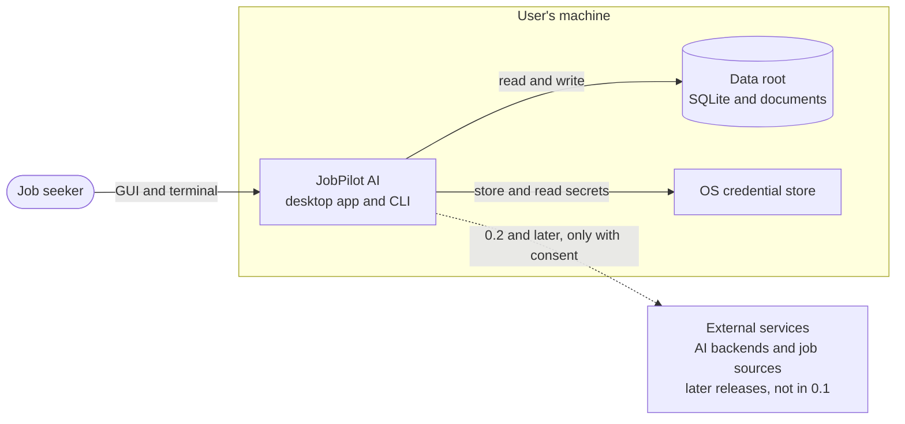
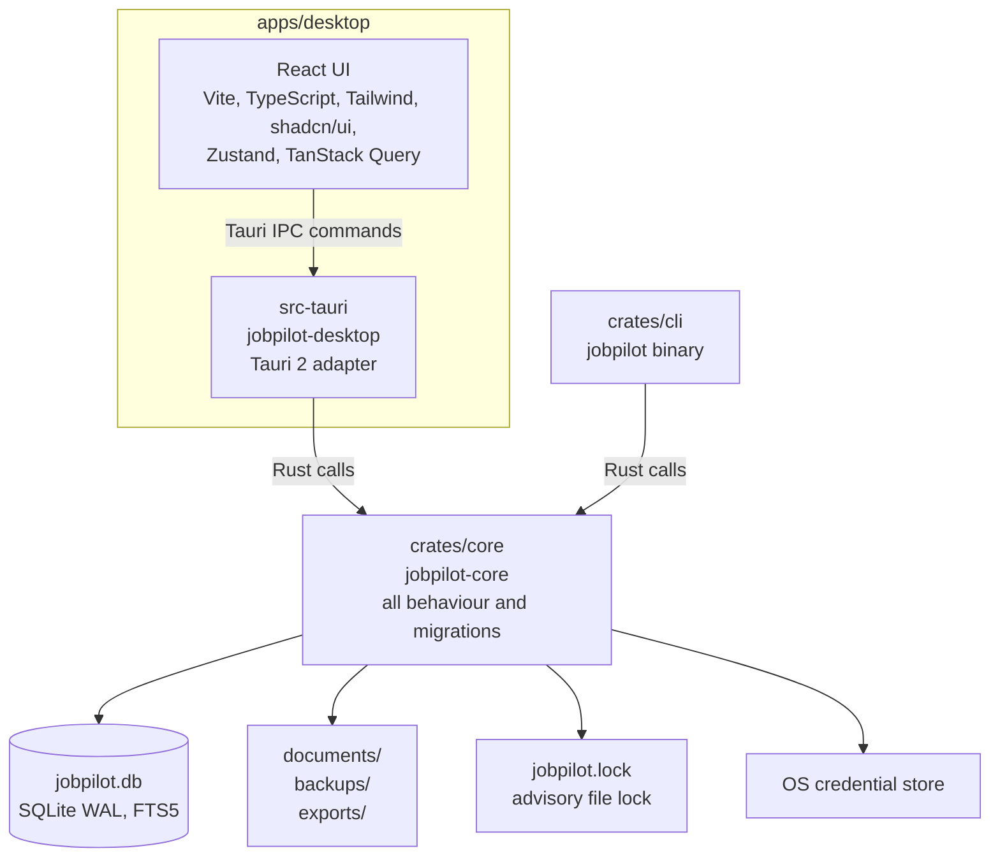
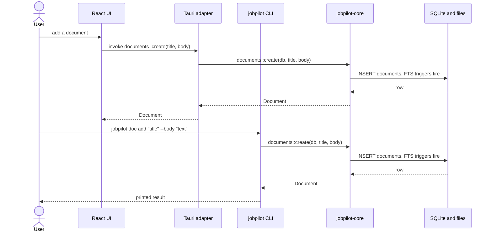
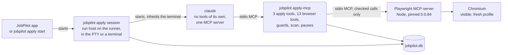

# JobPilot AI: Architecture

Status: draft for owner approval. Source: [master spec](superpowers/specs/2026-11-01-jobpilot-master-spec.md), [PRD](prd.md), and [milestone plan](milestones.md). Requirement IDs (`FR-<section>.<n>`) come from the PRD. Releases 0.1 to 0.6 are built; this document describes 0.1 in detail, adds the 0.2 to 0.6 modules, and names later pieces only as extension points.

Related documents: [AI providers](ai-providers.md), [policy register](policy-register.md), [threat model](security/threat-model.md), [agents](agents.md). They own connector, AI, security, and agent design. This document does not specify those designs. The database is described in [database-schema.md](database-schema.md).

## 1. Principles

- One library holds all behaviour (FR-10.13). The desktop app and the CLI are thin adapters over it.
- Local first. All user data lives under one data root on the user's machine (FR-2.1, FR-2.3). Release 0.1 makes no network call.
- No mandatory account, API key, or hosted backend (PRD goal G3).
- Targets are macOS (arm64, x86_64) and Windows x64 (FR-1.8).
- The webview never receives a secret value (FR-12.2, FR-2.9).

## 2. System context



The dotted edge does not exist in 0.1. Its rules are owned by the [AI providers](ai-providers.md) and [policy register](policy-register.md) documents.

## 3. Containers



| Container | Path | Role |
|---|---|---|
| React UI | `apps/desktop/src` | Renders views, calls typed IPC functions. Holds no business logic. |
| Tauri adapter | `apps/desktop/src-tauri` | Cargo package `jobpilot-desktop`. Exposes core services as Tauri commands. |
| CLI | `crates/cli` | Binary `jobpilot`. Parses arguments, calls core, prints text or JSON. |
| Core | `crates/core` | Crate `jobpilot-core`. All behaviour, error types, and `migrations/`. |
| Data root | see section 6 | One folder holding the database, documents, backups, exports, and lock. |

## 4. The GUI and the CLI reach the same service

Both adapters resolve the same data root, open the same database through `Db::open`, and call the same core function. They differ only in the `actor` string written to the audit log (`"gui"` or `"cli"`). This satisfies FR-10.13.



If the desktop app and the CLI run at the same time, SQLite WAL and the advisory lock (ADR 4) keep them from corrupting each other. Operations that replace the live files (restore, delete-all) are refused with `in_use` while another process holds a handle.

## 5. Repository structure

```text
jobpilot/
  Cargo.toml                 Cargo workspace
  rust-toolchain.toml        pins Rust 1.99.1
  package.json               pins pnpm@12.16.1
  pnpm-workspace.yaml
  crates/core/               jobpilot-core: all behaviour, migrations/
  crates/cli/                jobpilot binary
  apps/desktop/              React app
  apps/desktop/src-tauri/    Tauri adapter
  docs/                      published documentation
  .github/workflows/         ci.yml, release.yml
```

Cargo workspace members: `crates/core`, `crates/cli`, `apps/desktop/src-tauri`. The pnpm workspace covers `apps/desktop`. The workspace and shell are created in plan Task B1. This maps to FR-13.1.

Toolchain: Rust 1.99.1, Tauri 2.12, SQLx 0.9 with bundled SQLite, React 19, Vite 8.

## 6. Components

### 6.1 `crates/core` (`jobpilot-core`)

A library crate. It contains every behaviour in the product and nothing that depends on Tauri or on terminal I/O. Modules shipped in 0.1:

| Module | Responsibility | Requirements |
|---|---|---|
| `error` | Single `Error` enum and `Result<T>`. Each variant has a stable `code()` such as `in_use`. Serializes as `{"code", "message"}`. | Supporting; no FR of its own |
| `paths` | `AppPaths`: resolves the data root and the paths inside it. | FR-2.3 |
| `db` | `Db`: opens SQLite, applies pragmas, takes the file lock, checks schema version, snapshots and migrates. Exports `MIGRATOR`. | FR-2.1, FR-2.5 |
| `settings` | Key/value settings stored as JSON text. | Supporting storage; no FR of its own |
| `audit` | Append-only record of consequential actions. | FR-12.7 |
| `documents` | Create, read, update, delete, and search documents. Search uses FTS5. | FR-2.2, FR-2.3, FR-2.11, FR-3.21, FR-3.23 |
| `backup` | Create, list, and restore validated backups. | FR-2.6, FR-12.9 |
| `secrets` | Store secret values in the OS credential store and keep an index of names in the database. There is no read path outside Rust callers. | FR-2.9, FR-12.2 |
| `transfer` | Export all data and delete all data. | FR-2.7, FR-2.8, FR-12.10 |

Modules added in 0.2:

| Module | Responsibility | Requirements |
|---|---|---|
| `crypto` | The data key, AES-256-GCM field encryption, and `state`/`peek`, which classify the key as not loaded, unlocked, unavailable, missing, or mismatched. Opening a database never touches the keychain; the first sensitive use does. | FR-12.1 |
| `recovery` | Recovery-key export and import, and discard of locked fields behind a `pre-discard` snapshot. | FR-12.1 |
| `profile` | The international candidate profile. Work authorization is stored as stated, per country, encrypted, and never inferred. | FR-4.1 to FR-4.10 |
| `knowledge` | Knowledge base items (user-marked sensitive bodies sealed) and pasted job texts, normalized as untrusted. | FR-7.3, FR-12.3 |
| `parse` | PDF and DOCX resume import under size, time, and expansion limits. | FR-7.1, FR-7.2 |
| `render` | Resume model, two templates, DOCX and PDF output (DejaVu Sans embedded). | FR-7.5, FR-7.6 |
| `drafts`, `generate` | Versioned drafts with claim-level evidence, the guards in front of an export, and the prompts that produce them through the router. | FR-7.7 to FR-7.12 |
| `embed`, `hardware` | Embeddings stored as `f32` BLOBs with brute-force cosine search; machine memory and CPU for model fit. | FR-2.4, FR-3.5 |
| `ai` | `Router`, `Provider` and its implementations (`Ollama`, `ClaudeCode`, `NoAi`, and from 0.4 `ApiProvider`, `GeminiCli`, `CodexCli`), `validate`, `consent`, and `register`. See [AI providers](ai-providers.md#as-built-in-02) and [as built in 0.4](ai-providers.md#as-built-in-04). | FR-3.1 to FR-3.30 |

Data root layout, resolved by `AppPaths`:

```text
<root>/jobpilot.db       SQLite database (WAL mode)
<root>/documents/        user document files
<root>/backups/          snapshots and backups
<root>/exports/          data exports
<root>/jobpilot.lock     advisory lock file
<root>/.jobpilot-root    ownership marker holding the app identifier
<root>/.jobpilot-swap    present only while a restore is renaming files into place (0.2)
```

`<root>` is `JOBPILOT_HOME` when set, otherwise `dirs::data_dir()/io.github.gvsrusa.jobpilot`.

A root must be proven to be JobPilot's before anything touches it, because `JOBPILOT_HOME` can name any folder and on a case-insensitive volume `<home>/documents` is the user's `~/Documents`. `Db::open` and `backup::restore_offline` write `.jobpilot-root` first into a new or empty root, proceed if the marker exists, and refuse a non-empty root without one with `root_not_owned`, creating nothing. `transfer::delete_all` also refuses without the marker. Delete-all removes JobPilot's named paths only, and a symlink at one of those names goes without its target. It leaves `.jobpilot-root`, so a retry or the next open still finds an owned root; `jobpilot.lock`; `backups/` unless backups are included; and any file JobPilot did not name.

`Db::open` order: check the root's marker; create directories; take a shared lock on `jobpilot.lock` (a held exclusive lock maps to `in_use`); connect with `create_if_missing`, WAL, a 5 second busy timeout, and foreign keys on; read the highest applied migration and return `schema_too_new` if it exceeds the version the app knows; if migrations are pending, take the exclusive lock, write a `pre-migrate-<from>` snapshot when upgrading an existing database, run the migrations, and return to the shared lock.

Backup layout: `backups/<label>-<UTC stamp>/` holds `jobpilot.db` (written with `VACUUM INTO`), a copy of `documents/`, and `manifest.json` with `{format: 1, schema_version, created_at, wal}`. Restore validates the backup before touching live data, writes a `pre-restore` snapshot, closes the handle, and takes the exclusive lock. It then builds the new database as a temporary copy inside the root: it merges a WAL only if the manifest claims one, migrates an older backup forward, checks the schema, puts back the live `secret_index` names because secret values are never in a backup, writes the audit row, and checks the copy again. Next it renames the documents into place, clears the live `-wal` and `-shm`, renames the database into place, and reopens. A failure before the database rename leaves live data unchanged. Once that rename succeeds the restore has happened, so a failed reopen returns `restored_not_opened` rather than an error that reads as nothing changed. If step 2 fails on a corrupt database that still opens, restore falls through to the offline path, which copies the files instead of reading rows. Nothing deletes snapshots automatically.

Modules added in 0.3:

| Module | Responsibility | Requirements |
|---|---|---|
| `applications` | Application records and their history, with `check_change` validation shared with the tracking agent. A status change goes through `agents::set_status`. | FR-2.12 |
| `memory` | Career memory: questions, answers, sensitivity rules and classes (`rules`, `classify`), search (`search`, FTS5 and local embeddings), and the use gate (`usage`) that returns a sealed answer only after a person confirms it. Work authorization is read from the profile by exact country. | FR-8.1 to FR-8.8 |
| `runner` | The deterministic workflow runner: `Workflow`, `Agent`, the static permission sets (`perms`), run rows, heartbeats, checkpoints, retries, timeouts, and cancellation (`store`). | FR-11.10 to FR-11.16 |
| `agents` | The workflows on the runner: `tracking`, `analytics`, `draft` (resume and cover letter), and `memory` (refresh), plus `set_status`, `resume_run`, and `cancel_run`. | FR-11.3, FR-11.4, FR-11.5, FR-11.7, FR-11.9 |
| `analytics` | Aggregate queries over the application store, with no model and no network. | FR-10.11 |
| `pause` | The emergency pause flag in the database, the 250 ms watch, and the gates. | FR-12.8 |

Modules added in 0.4, inside `ai`:

| Module | Responsibility | Requirements |
|---|---|---|
| `net` | The two HTTP clients and `Retry-After`. `hosted_client` is native TLS (Schannel on Windows, Security.framework on macOS), HTTPS only, TLS 1.2 or later, no proxy, no redirect. `loopback_client` serves Ollama and the endpoint over `http` to a loopback address only. | FR-3.15 to FR-3.19, M-21 |
| `api` | `ApiProvider` and its five wires (OpenAI, OpenRouter, endpoint, Anthropic, Google), `classify_status`, `provider_schema`, model and endpoint checks, and `KeySource` (the keychain, or a fixed key in tests). | FR-3.15 to FR-3.19 |
| `child` | Shared rules for CLI children: the environment allow-list, `run_piped` with a process-tree kill, `version_of`, CLI discovery (`JOBPILOT_GEMINI_BIN`, settings, `PATH`, install folders, one login-shell lookup), and the `CliSpec` for Gemini and Codex. Claude Code uses the same helpers with its own list unchanged. | FR-3.10, FR-3.11, FR-3.12, M-15 |
| `gemini_cli`, `codex_cli` | The two optional CLI adapters. Gemini runs with every tool denied; Codex declares no `no_tools` and runs no task. | FR-3.10, FR-3.11, M-31 |
| `register` | The provider table, built from `docs/policy-register.md` by `include_str!`: row text for consent suspension, attestation, and data-use lines. | FR-3.30, M-30 |

The keychain path for a provider key is `secrets` (`set_api_key`, `read_api_key`, `delete_api_key`): the OS credential store under `ai-key-<name>`, `secret_index` holding only the name, reads inside a send. The desktop adapter adds `ai_key_from_clipboard` (Rust reads the clipboard through `tauri-plugin-clipboard-manager`, shows a native dialog, stores the key, clears the clipboard), and the CLI adds `ai key set` (a hidden prompt or piped stdin). Neither passes a key through the webview or argv.

Modules added in 0.5:

| Module | Responsibility | Requirements |
|---|---|---|
| `connectors` | The connector SDK: `ConnectorDecl`, the pure `request` and `parse` of each source, `check`, `gate`, `vet`, and `statuses`. `fetch` is the only file that opens a socket (`Fetcher`); `limit` keeps rate limits in the database. Lever, RemoteOK, We Work Remotely, Greenhouse, and Ashby read; Workday, Indeed, LinkedIn, and company pages only import a paste. The register is read at build time. See the [Connector SDK](connector-sdk.md). | FR-5.1 to FR-5.18, FR-13.5, M-33 |
| `jobs` | The job store: sources, jobs, companies, versioned job texts, import, upsert, duplicate groups (`dedupe`), parsing rules for place, pay, seniority and skills (`rules`, `geo`, `pay`), the weighted rules score (`score`), match preferences (`prefs`), the model's separate evaluation (`semantic`), and company notes (`company`). Every job text is made here, through `knowledge`. | FR-5.x, FR-6.1 to FR-6.12 |
| `agents::{discovery, matching, research}` | Three more workflows on the runner. `discovery` fetches source by source and then groups duplicates, with no model. `matching` fills blanks, scores by rules, and stores an optional evaluation. `research` summarizes a company from stored text. See [Agents](agents.md#4-the-nine-agents). | FR-11.1, FR-11.2, FR-11.8 |

Two task types, `semantic_match` and `summarize_company`, join the router ([AI providers](ai-providers.md#as-built-in-05)). Nothing else in `ai` changes.

Modules added in 0.6:

| Module | Responsibility | Requirements |
|---|---|---|
| `permissions` | The permissions engine: `Mode` (Manual, Copilot, Autonomous, ClaudeCode), `Action` (OpenLink, Supply, Drive, Fill, Upload, Submit), `Site`, `decide` and `decide_on` against the build-time register, the verified list (`VERIFIED`, empty), and the stored grant. `link_allowed` and `site_of` read a posting link; fixture sites on `127.0.0.1` exist only in debug builds. Autonomous grants (`grant`, `revoke`, `granted`) are a person's act and audited. | FR-9.5, FR-9.6, M-36 |
| `browser` | `runtime`: the pinned `@playwright/mcp` 0.0.84 (`assets/browser-runtime/package.json` and its lockfile), Node lookup (20 or later), `setup` (`npm ci --ignore-scripts`, then Chromium), `playwright_config` (visible, `chromium`, no anti-detection flag, downloads off, page tools off). `mcp`: a newline JSON-RPC MCP client over the server's stdio. `sweep`: `kill_marked`, which kills every process whose argv names a run folder, by `sysinfo`, on every OS. | FR-9.1, M-35 |
| `apply` | Run preparation and the Claude Code apply mode. `mod`: `preflight`, `start` (with the sealed release), `view`, `resolve_pause`, `cancel`, `settle`, `finish_items`, and Manual mode's `material` and `record_outcome`. `brief`: one application's facts and its two staged files. `guard`: the 13 browser tools, `scan` for the mandatory stops, `value_ok`, `field_guard`, `choice_guard`, `upload_ok`. `proxy`: `apply-mcp`, the MCP server `claude` sees, which forwards checked calls to Playwright. `session`: the `claude` argv, environment, and system prompt, the host's run, `cleanup` (sweep, delete, `claude purge`), and `sweep_orphans` at startup. | FR-9.7 to FR-9.21, M-37, M-38, M-39 |
| `forms` | `parse_snapshot` reads Playwright's accessibility snapshot into fields (no injected JavaScript), `map_rules` maps them by rules (FR-3.22), and `map_field` asks `map_form_field` for the rest. | FR-3.22, FR-9.7 to FR-9.9 |
| `agents::{browser, claude_apply}` | `browser`: the browser application workflow for Copilot and Autonomous on the runner. `claude_apply`: the Claude Code apply workflow (`prepare`, then `session`). | FR-11.6 |

`apply/mod.rs` and `apply/session.rs` hold the run's wind-up, which every ending shares: finish the items, settle their status, sweep, delete the run folder, and purge. The data root gains `<root>/browser-runtime/` (the installed server and Chromium) and `<root>/apply/` (one folder per run holding `mcp.json`, `playwright.json`, `files/`, `output/`, and the browser `profile/`, deleted at the end; and `apply/session/`, the fixed folder the interactive `claude` runs in, purged at the end). Backup and export skip both.

How a Claude Code apply run is put together. Rust chooses every process; the webview sends only an id and a terminal size.



Emergency pause reaches every box on the right by three paths: the host's 250 ms watch, the desktop closing the apply PTY before it writes the pause row, and the proxy refusing every call while the flag is set. Each then sweeps the run folder.

### 6.2 `crates/cli` (`jobpilot`)

A binary crate that depends on `jobpilot-core`. It parses arguments, calls core with actor `"cli"`, and prints text or, with `--json`, JSON. Errors go to standard error as `error[<code>]: <message>` with exit code 1. The 0.1 surface is `status`, `doc`, `backup`, and `data`. It contains no business logic. Later releases add the commands in FR-10.3 to FR-10.12. This is the 0.1 slice of FR-10.13.

The 0.5 CLI adds the `job` surface (alias `job src` for `job source`):

| Command | Does |
|---|---|
| `job paste <title>`, `job import --url <u> --title <t>` | Store a posting from standard input or `--file`. The link is kept and never requested. |
| `job list [--country C] [--mode remote\|hybrid\|onsite] [--min-pay 90000:EUR:year] [--all]`, `job search <q>`, `job show <id>` | Read stored jobs, best score first. A filter keeps a job that does not state the field. |
| `job remove <id>`, `job split <id>` | Remove a job, or say it is not a duplicate. |
| `job sources`, `job source add <connector> [target]`, `job source list`, `job source remove <id>` | Each source with its read status, limit, and attribution; add and remove a source. |
| `job fetch [--src <id>]...` | Read the sources, or only those named. |
| `job analyze [ids] [--ai --yes]` | Score by rules. With `--ai`, a model also fills blanks and writes an evaluation, after the call count is stated. |
| `job research <company-id> [--yes]`, `job company list`, `job company note <id>` | Summarize a company from stored text; list companies; store a pasted note. |
| `job prefs show`, `job prefs set [--min-pay ...] [--seniority ...]` | Wanted pay and seniority, which never reach a prompt. |

`job show <id> --json` prints the job detail as one object. Field names are the Rust field names; a missing value is `null`.

```text
{
  "job": {
    "id", "job_text_id", "connector", "title",
    "company", "company_id", "location", "country",
    "work_mode", "employment_type", "url", "attribution", "posted_on",
    "pay": { "min", "max", "currency", "period" } | null,
    "seniority", "skills": [..], "fields_by",
    "duplicate_of", "duplicates", "findings",
    "first_seen_at", "last_seen_at",
    "score", "scored", "stale", "not_stated": [..]
  },
  "text": "...",                       // the cleaned posting; untrusted
  "findings": [ { "kind", "excerpt" } ],
  "explanation": {
    "rows": [ { "criterion": "skills|seniority|location|pay",
                "weight", "points" | null, "note" } ],
    "score" | null, "compared_weight",
    "matched_skills": [..], "missing_skills": [..], "by": "rules"
  } | null,
  "semantic": { "fit", "summary", "strengths": [ { "text", "evidence_ids" } ],
                "gaps": [..], "dropped", "provider", "at" } | null,
  "group": [ <job>, .. ],             // the same job on other sources
  "authorization": { "kind": "no_country" }
                 | { "kind": "not_stated", "country" }
                 | { "kind": "stated", "country", "authorized", "needs_sponsorship" }
                 | { "kind": "locked" },
  "mentions_authorization": false,
  "notes": [ { "id", "text", "origin", "source_ref", "provider", "created_at" } ]
}
```

`pay.period` is `hour`, `day`, `week`, `month`, or `year`, and is `null` when the source names none. `authorized` and `needs_sponsorship` are `not_stated`, `yes`, or `no`. `points` is `null` for a criterion that was not compared. `by` is always `rules`: the model's number is only in `semantic.fit`.

The 0.6 CLI adds `browser` and `apply`. Each has a row in `PANEL`:

| Command | Does | In the panel |
|---|---|---|
| `browser status`, `browser setup` | Show the runtime's state (Node, pin, Chromium); download it. | status allowed; setup refused (it starts a download, as `ai pull` does) |
| `apply preflight <ids>` | Check up to 25 applications: runtime, `claude`, consent, documents, answers ready, sealed counts, blocks. It releases nothing, but it renders each application's resume and letter PDFs under `exports/apply/<application>/` and writes an `export` audit row, because export is the only path with every claim guard. | allowed |
| `apply start <ids> [--release-sealed]` | Start a Claude Code apply run and host it here. | refused |
| `apply session <id>`, `apply-mcp --dir <d>` | The run host and the proxy. Started by Rust, hidden. | refused |
| `apply status`, `apply show <run>` | Read a run. | allowed |
| `apply resolve <pause> continue\|take-over` | A person ends a pause. | allowed |
| `apply settle <run>`, `apply cancel <run>` | Write a submitted item's status after a pause; cancel a run. | allowed |
| `apply material <a>`, `apply record <a> --outcome <s> [--on d] [--note t]` | Manual mode: the material (no sealed value, and work authorization only as stated or not), and the outcome a person records. | allowed |
| `apply copilot <a>` | Run Copilot on one application. | refused |
| `apply autonomous list`, `grant <c>`, `revoke <c>`, `run <a>` | Autonomous grants, and its run, refused while no site is eligible. | list and revoke allowed; grant and run refused |

The 0.3 CLI adds `app` (add, list, show, history, edit, status, note, answers, remove), `memory` (add-question, add-answer, list, show, edit-answer, approve, unapprove, reviewed, set-class, reveal, confirm, use, authorization, remove-question, remove-answer, search, refresh), `agents` (list, show, log, cancel, resume), `analytics` (report, show), and `pause` (set, status, clear). Each has a row in the `PANEL` table, and what its GUI twin confirms natively (for example `pause clear`) is refused in the terminal panel.

The 0.2 CLI adds `profile`, `prefs`, `kb`, `job`, `resume`, `letter`, `ai`, and the `data recovery-key` commands, plus `jobpilot shell`, the restricted line interpreter the terminal panel runs. The desktop bundles this binary as a sidecar (`externalBin: binaries/jobpilot`). `apps/desktop/scripts/sidecar.mjs` builds it and copies it to `binaries/jobpilot-<target triple>`; `beforeBuildCommand` runs it, with `TAURI_ENV_TARGET_TRIPLE` set under `tauri build --target`, and CI runs it as its own step. Under `tauri dev` the script is not run, so build the CLI first.

### 6.3 `apps/desktop/src-tauri` (Tauri adapter, package `jobpilot-desktop`)

Holds `AppState`, which contains the `AppPaths`, an `RwLock<Option<Db>>` slot, and a `Mutex<Option<StartupError>>`. At startup it resolves paths and tries `Db::open`. If that fails (for example `schema_too_new`), it stores a `StartupError` and the app starts in recovery state instead of panicking. Commands that need data return `unavailable` in that state. `status` and `retry_open` always work.

`backup_restore` and `data_delete` take the write lock, take the `Db` out of its slot, call core, and always reopen before returning. There is deliberately no `secret_get` command, so secret values never cross IPC. The adapter uses the single-instance plugin so a second launch focuses the existing window, and the dialog plugin, which only Rust opens: `backup_restore` takes the name of a listed snapshot or opens a folder picker itself, so the webview names no path and holds no dialog permission (review-1.0 S-6). The webview Content Security Policy and capabilities are locked down in plan Task B1.

In 0.2 the adapter also holds `pty.rs`, which runs the sidecar in a PTY (`portable-pty`) for the panel with a marker in its environment so core can refuse the commands M-14 lists; `native.rs`, which owns the native dialogs for recovery files and destructive confirmations so those paths never cross the webview; and the AI commands. The webview cannot set `ai.claude_path`, give consent, or enable a provider through the panel. Exit cancels in-flight tasks and waits up to 5 seconds before leaving.

In 0.6 the adapter adds `pty_open_apply(cols, rows, apply_id)`, which opens the PTY on `jobpilot apply session <id>` for a run in state `ready` only, without the panel marker; `PtyState::close_apply`, which ends that session and sweeps its run folder; and the apply, browser, Copilot, and Autonomous commands (`browser_status`, `browser_setup`, `apply_preflight`, `apply_start`, `apply_view`, `apply_latest`, `apply_resolve_pause`, `apply_settle`, `apply_cancel`, `apply_material`, `apply_open`, `apply_record`, `apply_copy`, `copilot_start`, `autonomous_grants`, `autonomous_grant`, `autonomous_revoke`, `autonomous_start`). `apply_start` asks the sealed release in a native dialog, so the webview cannot release anything. `pause_now` and `stop_if_paused` close the apply PTY and sweep before the pause row is written. Startup runs `sweep_orphans` once, off the setup thread.

In 0.3 the adapter adds `menu.rs`, which builds the native menu with a `Safety` submenu whose Emergency pause item carries the `CmdOrCtrl+Shift+H` accelerator, and the pause watcher, which polls the stored flag and fires the in-flight tokens. Commands for applications, memory, agents, analytics, and pause go in `handler()` and in the `ALLOWED_COMMANDS` list the tests compare, and the destructive ones (confirming a sensitive use, clearing the pause) ask through `native.rs`.

### 6.4 `apps/desktop/src` (React frontend)

Built with Vite, Tailwind CSS, shadcn/ui, Zustand for client state, and TanStack Query for async state (FR-1.2, FR-1.3, FR-1.5 to FR-1.7). Areas in 0.1:

| Area | Path | Purpose |
|---|---|---|
| IPC layer | `src/lib/ipc.ts` | One typed function per Tauri command. Types are hand-written and kept in sync with the adapter. |
| UI store | `src/lib/store.ts` | Zustand store holding the current view. |
| Status view | `src/views/StatusView.tsx` | Schema version, app version, data root, and database state. |
| Documents view | `src/views/DocumentsView.tsx` | List, create, edit, delete, and search documents. |
| Data view | `src/views/DataView.tsx` | Backup, restore, export, delete-all, secrets, and recent audit entries. |
| Recovery view | `src/views/RecoveryView.tsx` | Shown when the database failed to open. Offers retry and restore from backup. |
| Profile view | `src/views/ProfileView.tsx` | Name, places, work modes, work authorization, locked fields, and the recovery-key panel (0.2). |
| Resumes view | `src/views/ResumesView.tsx` | Resume import, knowledge items, job texts, drafts, comparison, and export (0.2). |
| AI view | `src/views/AiView.tsx` | Providers, order, consent, Ollama models and downloads, and the Claude path (0.2); in 0.4 a row per hosted provider, the endpoint, and the two CLIs, with key, model, path, and consent controls (`ProviderRow`). |
| Terminal panel | `src/components/TerminalPanel.tsx` | xterm.js on the PTY. Ctrl+` shows or hides it, F6 leaves it (0.2). |
| Applications view | `src/views/ApplicationsView.tsx` | Add, filter, edit, and change the status of applications, their history, the answers an application used, and the analytics summary (0.3). |
| Memory view | `src/views/MemoryView.tsx` | Questions, answers, classes, approval, search, and the refresh with its call count (0.3). |
| Agents view | `src/views/AgentsView.tsx` | Runs and their logs, with resume and cancel (0.3). |
| Jobs view | `src/views/JobsView.tsx`, `src/views/JobDetail.tsx` | Ctrl+0. Sources with their read status and a Fetch button, filters, the job list, paste, preferences, and the job detail with its explained score (0.5). It holds no scoring logic: Rust scores. |
| Application review | `src/views/ApplicationReview.tsx`, `src/views/CopilotRun.tsx` | Wireframe 11: the four modes with Rust's fixed notes, material, answers copied by Rust, Open the form, Record outcome, and Copilot's run (0.6). |
| Apply run | `src/views/ApplyRun.tsx`, `src/components/PausePanel.tsx` | Wireframe 19: Setup needed, Preflight, Running, Ended, and the pause panel (0.6). Page text renders inert. |
| Title bar | `src/components/TitleBar.tsx` | First in the page on every screen: the Emergency pause button, the paused notice, and Clear pause (0.3). |

Screen layouts are in the UI wireframes (plan Task A5) and are not repeated here.

## 7. Architecture decision records

### ADR 1: Core library plus thin adapters

- Context: the GUI and the terminal must call the same underlying services (FR-10.13), and tests must run without a window.
- Decision: put all behaviour in `jobpilot-core`. The Tauri app and the CLI only translate input and output and pass an actor name.
- Consequences: behaviour is tested once, in core, with a temporary data root. Adapters stay small. A new adapter, such as a PTY panel in 0.2, reuses core unchanged. The cost is that core must not depend on Tauri types.

### ADR 2: Runtime SQLx queries

- Context: SQLx can check queries at compile time (`query!`), which needs `DATABASE_URL` or `sqlx-cli` at build time.
- Decision: use the runtime `sqlx::query` functions. Migrations still run through `sqlx::migrate!()`.
- Consequences: a clean checkout builds on macOS and Windows with no database and no extra tool. Query mistakes surface in tests, not at compile time, so each query needs a test. Revisit if the query count makes this costly.

### ADR 3: One data root, not Tauri path APIs

- Context: Tauri path helpers are available only inside the desktop app. The CLI must find the same files.
- Decision: core resolves the data root itself: `JOBPILOT_HOME` if set, otherwise `dirs::data_dir()/io.github.gvsrusa.jobpilot`. The app identifier is `io.github.gvsrusa.jobpilot`.
- Consequences: the GUI and CLI always agree on the location. Tests and portable setups can redirect everything with one environment variable. The location follows platform conventions through `dirs`.

### ADR 4: Advisory file lock for multi-process safety

- Context: the desktop app and the CLI can run at once. WAL handles concurrent reads and writes, but restore and delete-all replace files and must not run while another process is attached.
- Decision: every `Db` holds a shared lock on `jobpilot.lock`. Migration, restore, and delete-all take it exclusively. A lock that cannot be taken returns `in_use`.
- Consequences: normal use from both adapters works together. Destructive operations are refused rather than racing. The lock is advisory, so it protects only processes that use JobPilot core, which is the intended scope.

## 8. Extension points for later releases

These are named so that 0.1 does not block them. They are not designed here.

| Later area | Release | Owner document |
|---|---|---|
| AI task router and providers | 0.2, 0.4 | [ai-providers.md](ai-providers.md) |
| Connector SDK and policy review | 0.5 (built) | [connector-sdk.md](connector-sdk.md), [policy-register.md](policy-register.md) |
| Threat model and prompt-injection controls | 0.1 onward | [security/threat-model.md](security/threat-model.md) |
| Agents and workflow runner | 0.3, 0.5, 0.6 (built) | [agents.md](agents.md) |
