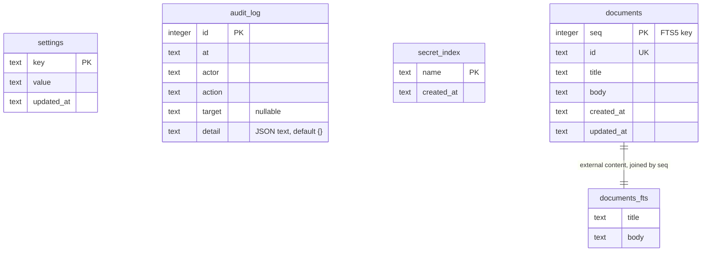
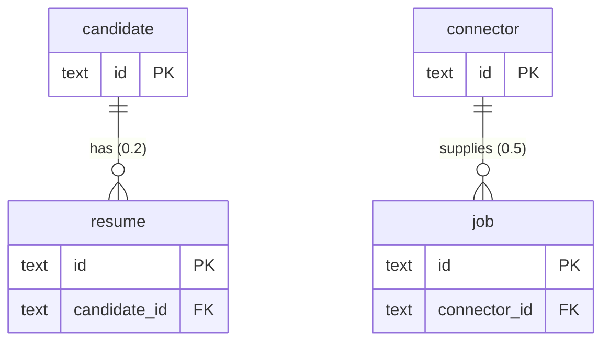

# JobPilot AI: Database Schema

Status: draft for owner approval. Source: [master spec](superpowers/specs/2026-11-01-jobpilot-master-spec.md), [PRD](prd.md), [architecture](architecture.md). Requirement IDs (`FR-<section>.<n>`) come from the PRD. Sections 1 (release 0.1), 2 (release 0.2), and 3 (release 0.3) are implemented; section 5 is still a proposal. `schema_version` is 11 on a fresh database, and migration `0011` is the last.

The database is SQLite accessed through SQLx (FR-2.1) and managed by versioned migrations (FR-2.5). It lives at `<data root>/jobpilot.db`, in WAL mode with foreign keys on. Full-text search uses FTS5 (FR-2.2).

## 1. Release 0.1 tables (decided, shipped)

Migration `crates/core/migrations/0001_foundation.sql` creates these tables. They are decided design.



`settings`, `audit_log`, and `secret_index` have no foreign keys and stand alone.

### Tables

| Table | Purpose | Requirements |
|---|---|---|
| `settings` | Key/value application settings. `value` is JSON text. | Supporting storage |
| `audit_log` | Append-only record of consequential actions (backup, restore, export, delete, secret change). `actor` is `gui`, `cli`, or `system`. `detail` is JSON text and never holds a secret value. Delete-all removes this table's rows by design. | FR-12.7 |
| `secret_index` | Names of secrets held in the OS credential store, with creation time. It never stores values. Restore keeps the live rows, because the secrets stay in the credential store. | FR-2.9, FR-12.2 |
| `documents` | User documents. `id` is the text identifier the app uses. `seq` is the internal key the search index joins on. Timestamps are text. | FR-2.3, FR-2.11, FR-3.23 |
| `documents_fts` | FTS5 virtual table over `documents.title` and `documents.body`. | FR-2.2, FR-3.21 |

### DDL

```sql
CREATE TABLE settings (key TEXT PRIMARY KEY, value TEXT NOT NULL, updated_at TEXT NOT NULL);
CREATE TABLE audit_log (id INTEGER PRIMARY KEY, at TEXT NOT NULL, actor TEXT NOT NULL,
  action TEXT NOT NULL, target TEXT, detail TEXT NOT NULL DEFAULT '{}');
CREATE TABLE secret_index (name TEXT PRIMARY KEY, created_at TEXT NOT NULL);
CREATE TABLE documents (seq INTEGER PRIMARY KEY, id TEXT NOT NULL UNIQUE, title TEXT NOT NULL,
  body TEXT NOT NULL, created_at TEXT NOT NULL, updated_at TEXT NOT NULL);
```

`documents_fts` is an external-content FTS5 table over `title` and `body`, with `tokenize='unicode61 remove_diacritics 2'`. Insert, update, and delete triggers on `documents` keep the index in step. It reads content from `documents` and is matched to rows by `seq` (`content_rowid='seq'`). The key is declared because SQLite does not promise that `VACUUM` keeps implicit rowids, and every backup uses `VACUUM INTO`.

Known limit: `unicode61` does not segment Chinese, Japanese, or Korean text. When those users appear, move to the `trigram` tokenizer or a segmenter. The migration file carries a `ponytail:` comment naming this ceiling.

`.gitattributes` forces `*.sql text eol=lf`, because SQLx migration hashes differ between CRLF and LF line endings.

### Data outside the database

| Item | Location |
|---|---|
| Document files | `<root>/documents/` |
| Backups and snapshots | `<root>/backups/<label>-<UTC stamp>/` with `jobpilot.db`, `documents/`, and `manifest.json`. A `pre-restore` snapshot made with no open database may also hold `-wal` and `-shm`, and its manifest `schema_version` may be `null`. |
| Exports | `<root>/exports/` |
| Secret values | OS credential store, service `io.github.gvsrusa.jobpilot` |
| Swap marker | `<root>/.jobpilot-swap`, written for the moment a restore renames documents and the database into place. If one is found at the next open, the app says a restore was interrupted (0.2). |
| Root ownership marker | `<root>/.jobpilot-root`, holding the app identifier. `Db::open` and offline restore refuse a non-empty root without it (`root_not_owned`), and delete-all keeps it. |

Nothing deletes snapshots automatically. `pre-migrate`, `pre-restore`, and from 0.2 `pre-discard` folders stay until the user removes them or delete-all runs with backups included.

## 2. Release 0.2 tables (decided)

Migrations `0002` to `0005` add the tables below, on top of the 0.1 tables. Each file opens with its rule 7 note, which says how backup, export, and delete-all treat the data, and the DDL here is the file as shipped. `schema_version` is 5 on a fresh database.

| Migration | Tables | Class and handling |
|---|---|---|
| `0002_data_keys_profile.sql` | `data_keys`, `profile`, `work_authorization` | `data_keys` holds key ids and a key-check value, never key material. `profile.basic` is Personal, plain. `work_authorization` is Sensitive: ciphertext (JPK1, AES-256-GCM, [threat model section 8](security/threat-model.md#8-encryption-decision)), written plain to an export only after a warning. Delete-all removes the root and this root's keychain entries. |
| `0003_knowledge_drafts.sql` | `knowledge_items`, `job_texts`, `drafts`, `claims`, `embeddings` | Personal, except `job_texts` (Untrusted: pasted postings, only `normalized` reaches a model, inside a data block). A marked knowledge body is Sensitive: `body = ''` and `body_enc` holds ciphertext. `claims` rows give every line of a generated draft its evidence ids and a status of `ok`, `no_evidence`, `authorization_statement`, or `removed`; a status other than `ok` blocks export. Export drops the BLOB columns. |
| `0004_ai_runs_consent.sql` | `task_runs`, `consent` | `task_runs` holds codes, durations, and outcomes, never prompts or outputs, and is never pruned. `consent` is one row per grant, keyed by provider text such as `claude_code/cli_login`, with its categories, UTC times, and the terms date. |
| `0005_embeddings_per_model.sql` | rebuilds `embeddings` | The key becomes `(item_id, model)`, so a changed embedding model keeps the old vectors. Marking an item deletes its rows. |

```sql
-- rule 7: data_keys holds no plaintext secret; backup copies it; export lists key ids only;
-- delete-all removes the root and this root's keychain entries.
CREATE TABLE data_keys (key_id TEXT PRIMARY KEY, created_at TEXT NOT NULL,
  key_check BLOB NOT NULL, active INTEGER NOT NULL DEFAULT 0);
-- rule 7: profile.basic is Personal class, plain; copied by backup, exported, deleted with the root.
CREATE TABLE profile (id TEXT PRIMARY KEY CHECK (id = 'me'), basic TEXT NOT NULL, updated_at TEXT NOT NULL);
-- rule 7: work_authorization is Sensitive class; ciphertext only in backups; export writes it plain
-- after a warning; delete-all removes it with the root.
CREATE TABLE work_authorization (country TEXT PRIMARY KEY, ciphertext BLOB NOT NULL,
  key_id TEXT NOT NULL REFERENCES data_keys(key_id), updated_at TEXT NOT NULL);
```

```sql
-- rule 7, for every table below: backup copies the database whole (VACUUM INTO), so a marked
-- knowledge body is ciphertext there. Export writes each table without its BLOB columns
-- (body_enc, vector); a marked item exports with an empty body. Delete-all removes them
-- with the root.
-- seq is the integer key (see documents in 0001): VACUUM INTO does not promise implicit
-- rowids, so the order of rows must not depend on them.

-- Personal class. A marked body is Sensitive class: body = '' and body_enc holds JPK1
-- ciphertext (table knowledge_items, column body_enc, row id = id). Discard clears body_enc
-- and keeps the row. An unmarked item is the only kind that is ever evidence.
CREATE TABLE knowledge_items (
  seq INTEGER PRIMARY KEY,
  id TEXT NOT NULL UNIQUE,
  kind TEXT NOT NULL CHECK (kind IN ('experience','education','skill','project','achievement','note')),
  body TEXT NOT NULL,
  body_enc BLOB,
  key_id TEXT REFERENCES data_keys(key_id),
  source TEXT NOT NULL CHECK (source IN ('user','parsed')),
  source_ref TEXT,
  approved INTEGER NOT NULL DEFAULT 0 CHECK (approved IN (0,1)),
  marked_sensitive INTEGER NOT NULL DEFAULT 0 CHECK (marked_sensitive IN (0,1)),
  created_at TEXT NOT NULL,
  updated_at TEXT NOT NULL,
  CHECK (body_enc IS NULL OR (body = '' AND key_id IS NOT NULL AND marked_sensitive = 1))
);

-- Untrusted class: pasted job text. Only `normalized` may reach a model, inside a data block.
CREATE TABLE job_texts (
  seq INTEGER PRIMARY KEY,
  id TEXT NOT NULL UNIQUE,
  title TEXT NOT NULL,
  raw TEXT NOT NULL,
  normalized TEXT NOT NULL,
  findings TEXT NOT NULL DEFAULT '[]',
  created_at TEXT NOT NULL
);

-- Personal class. body is a JSON ResumeDoc.
CREATE TABLE drafts (
  id TEXT PRIMARY KEY,
  kind TEXT NOT NULL CHECK (kind IN ('resume','cover_letter')),
  lineage_id TEXT NOT NULL,
  version INTEGER NOT NULL,
  origin TEXT NOT NULL CHECK (origin IN ('uploaded','generated','edited')),
  title TEXT NOT NULL,
  job_text_id TEXT REFERENCES job_texts(id),
  provider TEXT,
  body TEXT NOT NULL,
  created_at TEXT NOT NULL,
  UNIQUE (lineage_id, version)
);

CREATE TABLE claims (
  id TEXT PRIMARY KEY,
  draft_id TEXT NOT NULL REFERENCES drafts(id) ON DELETE CASCADE,
  position INTEGER NOT NULL,
  text TEXT NOT NULL,
  evidence_ids TEXT NOT NULL DEFAULT '[]',
  status TEXT NOT NULL CHECK (status IN ('ok','no_evidence','authorization_statement','removed'))
);

-- Derived from unmarked knowledge text. Marking an item deletes its vector.
CREATE TABLE embeddings (
  item_id TEXT PRIMARY KEY REFERENCES knowledge_items(id) ON DELETE CASCADE,
  model TEXT NOT NULL,
  dims INTEGER NOT NULL,
  vector BLOB NOT NULL,
  created_at TEXT NOT NULL
);
```

```sql
-- rule 7: task_runs holds no prompts, outputs, or secrets: reason is a code. consent is
-- Personal class. Backup copies both with the whole database, export writes both, and
-- delete-all removes them with the root.
CREATE TABLE task_runs (
  id TEXT PRIMARY KEY,
  task_type TEXT NOT NULL,
  provider TEXT NOT NULL,
  data_categories TEXT NOT NULL,
  started_at TEXT NOT NULL,
  duration_ms INTEGER NOT NULL,
  attempt INTEGER NOT NULL,
  outcome TEXT NOT NULL,
  reason TEXT
);

CREATE TABLE consent (
  provider TEXT NOT NULL,
  categories TEXT NOT NULL,
  given_at TEXT NOT NULL,
  revoked_at TEXT,
  terms_date TEXT NOT NULL,
  PRIMARY KEY (provider, given_at)
);
```

```sql
-- rule 7: embeddings are derived from unmarked knowledge text and are Personal class.
-- Backup copies them with the whole database, export writes them, and delete-all removes
-- them with the root. Marking an item deletes its rows. 0003 keyed a row by item alone;
-- a changed embedding model must keep the old rows, so the key becomes (item, model).
CREATE TABLE embeddings_new (
  item_id TEXT NOT NULL REFERENCES knowledge_items(id) ON DELETE CASCADE,
  model TEXT NOT NULL,
  dims INTEGER NOT NULL,
  vector BLOB NOT NULL,
  created_at TEXT NOT NULL,
  PRIMARY KEY (item_id, model)
);
INSERT INTO embeddings_new SELECT item_id, model, dims, vector, created_at FROM embeddings;
DROP TABLE embeddings;
ALTER TABLE embeddings_new RENAME TO embeddings;
```

Snapshots: `pre-migrate-<from>-<stamp>` is written before any migration on a database that holds data, and `pre-discard-<stamp>` before locked fields are discarded. Neither is pruned.

## 3. Release 0.3 tables (decided, shipped)

Migrations `0006` to `0011` add the tables below, on top of the 0.2 tables. Each file opens with its rule 7 note, which says how backup, export, and delete-all treat the data. `schema_version` is 11 on a fresh database, and a 0.2 database (version 5) opens at 11 after a `pre-migrate-5-*` snapshot, with every earlier row intact and the new tables empty (`a_0_2_database_upgrades_to_0_3`).

| Migration | Tables | Class and handling |
|---|---|---|
| `0006_applications.sql` | `applications`, `application_events` | Personal, plain. Backup copies them with the database, export writes both, delete-all removes them with the root. Holds no work authorization. `application_events` is the history: created, status, note, and edited, with the actor. |
| `0007_career_memory.sql` | `memory_questions`, `memory_answers`, `application_answers` | Questions and unsealed answers are Personal, plain. A body in a class above `normal` is Sensitive: `body = ''` and `body_enc` holds JPK1 ciphertext (a new ciphertext column, so it joins the key checks in `crypto.rs` and `recovery.rs`). Backup copies the ciphertext with the database. `data.json` drops BLOB columns and blanks a plain body under a sealed class, and `memory_sealed_answers.json` holds the plain text, private on Unix, only when the key is unlocked and after the export warning. `memory_questions.class_source` is `rules`, `model`, or `user`, and `user` is final. `application_answers` holds ids, versions, and times for confirmations, never answer text. Delete-all removes all three with the root. |
| `0008_memory_search.sql` | `memory_fts`, `memory_embeddings` | Derived, and rebuilt from the questions and plain answers. A work-authorization question has no row in either table, and a sealed class indexes the question only. Export skips them. Backup copies them, delete-all removes them. The migration backfills `memory_fts` for questions that exist already. |
| `0009_agent_runs.sql` | `agent_runs`, `agent_run_log` | Ids, enum choices, codes, and durations, never a prompt, an output, posting text, an answer, or a secret (M-26). `input` keeps what a resume needs (for a status update the application id, status, and date, never its note). `generation` counts resumes, and `cancel_actor` is who asked first. `waiting_for_human` is in the state `CHECK` and is never entered in 0.3. Backup copies them, export writes them, delete-all removes them. |
| `0010_reports.sql` | `reports` | Counts and rates only, no company, role, or note. `complete = 0` marks a report still being built. Backup copies it, export writes it, delete-all removes it. |
| `0011_emergency_pause.sql` | `emergency_pause`, and `drafts.run_id` | `emergency_pause` has one row while the pause is on: who set it and when, no personal data. A restore never clears it. `drafts.run_id` is the id of the run that made a generated version, so a run that repeats its draft step after a failed checkpoint write finds its version and calls no model again. |

Other rules the migrations follow: runtime SQL only, LF line endings, and no file edited after it shipped.

## 4. Migration rules

1. Forward only. There are no down migrations. Recovery from a bad migration is a restore from the snapshot.
2. Snapshot before migrating. When pending migrations exist and the database already holds data, core writes `backups/pre-migrate-<from>-<stamp>/` before applying anything. A failed migration leaves the snapshot and the previous data in place.
3. Never edit an applied migration file. SQLx records a hash of each applied file, so an edited file breaks every existing install. Fix mistakes with a new migration.
4. Refuse newer schemas. If the database holds a version higher than the app knows, the app opens in recovery state with `schema_too_new` and changes nothing.
5. Files are numbered `NNNN_name.sql` in `crates/core/migrations/`, use LF line endings, and are embedded with `sqlx::migrate!()`.
6. Every release must apply cleanly to a fresh database and upgrade the previous release's database (milestone gate 3). Restoring an older backup migrates it forward.
7. A migration that creates a table holding personal data must say how backup, export, and delete-all handle it.

## 5. Proposed later entities (not decided)

This diagram is a proposal only, and it predates the 0.2 and 0.3 designs: the candidate and resume entities shipped under the names in section 2, and the application, answer, and agent run entities under the names in section 3. It shows how later releases might extend the schema. Table names, columns, and relationships are not decided and will be fixed in the release that adds them, each with its own migration. Connector, AI, and agent details are owned by [policy-register.md](policy-register.md), [ai-providers.md](ai-providers.md), and [agents.md](agents.md). Release targets come from the [milestone plan](milestones.md).



Proposed entities and their planned release:

| Entity (proposed) | Release | Notes |
|---|---|---|
| candidate | 0.2, built | Shipped as `profile` and `work_authorization` (section 2). |
| resume | 0.2, built | Shipped as `knowledge_items`, `drafts`, and `claims` (section 2). |
| application, answer, agent_run | 0.3, built | Shipped as `applications` and `application_events`, `memory_questions` and `memory_answers`, and `agent_runs` and `agent_run_log` (section 3). |
| job, connector | 0.5 | Connector declarations and discovered jobs (FR-5, FR-6). |
