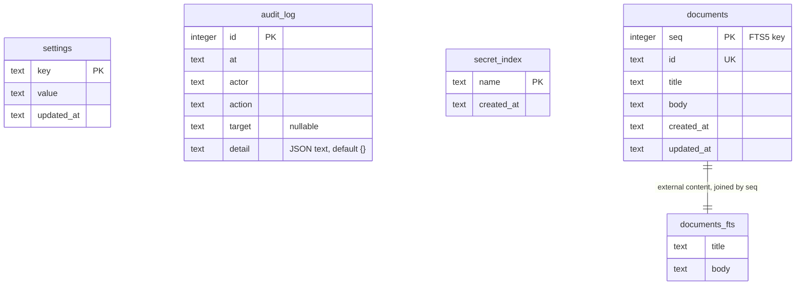
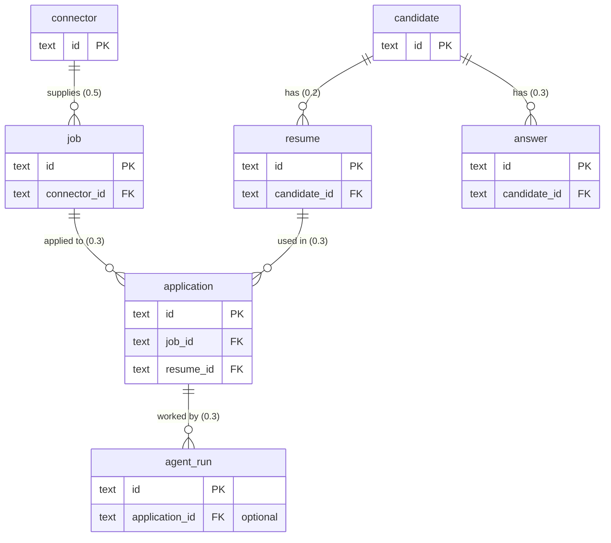

# JobPilot AI: Database Schema

Status: draft for owner approval. Source: [master spec](superpowers/specs/2026-11-01-jobpilot-master-spec.md), [PRD](prd.md), [architecture](architecture.md). Requirement IDs (`FR-<section>.<n>`) come from the PRD. Nothing here is implemented yet.

The database is SQLite accessed through SQLx (FR-2.1) and managed by versioned migrations (FR-2.5). It lives at `<data root>/jobpilot.db`, in WAL mode with foreign keys on. Full-text search uses FTS5 (FR-2.2).

## 1. Release 0.1 tables (decided)

Migration `crates/core/migrations/0001_foundation.sql` creates these tables. They are decided design.



`settings`, `audit_log`, and `secret_index` have no foreign keys and stand alone.

### Tables

| Table | Purpose | Requirements |
|---|---|---|
| `settings` | Key/value application settings. `value` is JSON text. | Supporting storage |
| `audit_log` | Append-only record of consequential actions (backup, restore, export, delete, secret change). `actor` is `gui`, `cli`, or `system`. `detail` is JSON text and never holds a secret value. Delete-all removes this table's rows by design. | FR-12.7 |
| `secret_index` | Names of secrets held in the OS credential store, with creation time. It never stores values. Restore keeps the live rows, because the secrets stay in the credential store. | FR-2.9, FR-12.2 |
| `documents` | User documents. `id` is the text identifier the app uses. `seq` is the internal key the search index joins on. Timestamps are text. | FR-2.3, FR-2.11, FR-3.23 |
| `documents_fts` | FTS5 virtual table over `documents.title` and `documents.body`. | FR-2.2, FR-3.21 |

### DDL

```sql
CREATE TABLE settings (key TEXT PRIMARY KEY, value TEXT NOT NULL, updated_at TEXT NOT NULL);
CREATE TABLE audit_log (id INTEGER PRIMARY KEY, at TEXT NOT NULL, actor TEXT NOT NULL,
  action TEXT NOT NULL, target TEXT, detail TEXT NOT NULL DEFAULT '{}');
CREATE TABLE secret_index (name TEXT PRIMARY KEY, created_at TEXT NOT NULL);
CREATE TABLE documents (seq INTEGER PRIMARY KEY, id TEXT NOT NULL UNIQUE, title TEXT NOT NULL,
  body TEXT NOT NULL, created_at TEXT NOT NULL, updated_at TEXT NOT NULL);
```

`documents_fts` is an external-content FTS5 table over `title` and `body`, with `tokenize='unicode61 remove_diacritics 2'`. Insert, update, and delete triggers on `documents` keep the index in step. It reads content from `documents` and is matched to rows by `seq` (`content_rowid='seq'`). The key is declared because SQLite does not promise that `VACUUM` keeps implicit rowids, and every backup uses `VACUUM INTO`.

Known limit: `unicode61` does not segment Chinese, Japanese, or Korean text. When those users appear, move to the `trigram` tokenizer or a segmenter. The migration file carries a `ponytail:` comment naming this ceiling.

`.gitattributes` forces `*.sql text eol=lf`, because SQLx migration hashes differ between CRLF and LF line endings.

### Data outside the database

| Item | Location |
|---|---|
| Document files | `<root>/documents/` |
| Backups and snapshots | `<root>/backups/<label>-<UTC stamp>/` with `jobpilot.db`, `documents/`, and `manifest.json`. A `pre-restore` snapshot made with no open database may also hold `-wal` and `-shm`, and its manifest `schema_version` may be `null`. |
| Exports | `<root>/exports/` |
| Secret values | OS credential store, service `io.github.gvsrusa.jobpilot` |
| Root ownership marker | `<root>/.jobpilot-root`, holding the app identifier. `Db::open` and offline restore refuse a non-empty root without it (`root_not_owned`), and delete-all keeps it. |

Nothing deletes snapshots automatically. `pre-migrate`, `pre-restore`, and from 0.2 `pre-discard` folders stay until the user removes them or delete-all runs with backups included.

## 2. Migration rules

1. Forward only. There are no down migrations. Recovery from a bad migration is a restore from the snapshot.
2. Snapshot before migrating. When pending migrations exist and the database already holds data, core writes `backups/pre-migrate-<from>-<stamp>/` before applying anything. A failed migration leaves the snapshot and the previous data in place.
3. Never edit an applied migration file. SQLx records a hash of each applied file, so an edited file breaks every existing install. Fix mistakes with a new migration.
4. Refuse newer schemas. If the database holds a version higher than the app knows, the app opens in recovery state with `schema_too_new` and changes nothing.
5. Files are numbered `NNNN_name.sql` in `crates/core/migrations/`, use LF line endings, and are embedded with `sqlx::migrate!()`.
6. Every release must apply cleanly to a fresh database and upgrade the previous release's database (milestone gate 3). Restoring an older backup migrates it forward.
7. A migration that creates a table holding personal data must say how backup, export, and delete-all handle it.

## 3. Proposed later entities (not decided)

This diagram is a proposal only. It shows how later releases might extend the schema. Table names, columns, and relationships are not decided and will be fixed in the release that adds them, each with its own migration. Connector, AI, and agent details are owned by [policy-register.md](policy-register.md), [ai-providers.md](ai-providers.md), and [agents.md](agents.md). Release targets come from the [milestone plan](milestones.md).



Proposed entities and their planned release:

| Entity (proposed) | Release | Notes |
|---|---|---|
| candidate | 0.2 | Profile with encrypted sensitive fields (FR-4, FR-12.1). Work authorization is stored as the user states it and never inferred (FR-4.9, FR-4.10). |
| resume | 0.2 | Versioned, with claim-level provenance (FR-7.9, FR-7.11). |
| application | 0.3 | Tracking history, viewable and editable offline (FR-2.12). |
| answer | 0.3 | Career memory with approval, provenance, freshness, sensitivity (FR-8). |
| agent_run | 0.3 | Execution logs, checkpoints (FR-11.12, FR-11.15). |
| job, connector | 0.5 | Connector declarations and discovered jobs (FR-5, FR-6). |
